<div align="center">

<picture>
  <source media="(prefers-color-scheme: dark)" srcset=".github/assets/banner-dark.svg">
  <source media="(prefers-color-scheme: light)" srcset=".github/assets/banner-light.svg">
  
</picture>

<h3>National material-code harmonization for India's public-sector enterprises</h3>

<p>
Every CPSE writes the same bolt differently. SANGAM reads the <b>specification</b> behind the words,<br>
resolves every variant to <b>one national identity</b>, and refuses, outright, to merge parts that only <i>look</i> alike.
</p>

<p>
<a href="#how-sangam-decides"></a>
<a href="#architecture"></a>
<a href="#the-machine-learning-honestly"></a>
<a href="#the-machine-learning-honestly"></a>
<a href="#data"></a>
<br>
<a href="#platform-tour"></a>
<a href="#platform-tour"></a>
<a href="#platform-tour"></a>
<a href="#platform-tour"></a>
<a href="#quickstart"></a>
<a href="#problem"></a>
</p>

<p>
<a href="#problem"><b>Problem</b></a> ·
<a href="#how-sangam-decides"><b>How it decides</b></a> ·
<a href="#measured-not-claimed"><b>Results</b></a> ·
<a href="#platform-tour"><b>Tour</b></a> ·
<a href="#architecture"><b>Architecture</b></a> ·
<a href="#the-machine-learning-honestly"><b>ML</b></a> ·
<a href="#data"><b>Data</b></a> ·
<a href="#quickstart"><b>Quickstart</b></a>
</p>

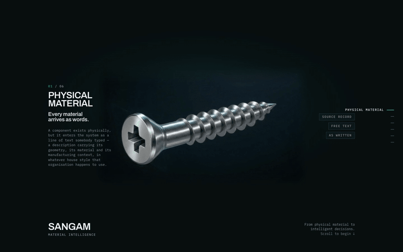

<sub>The landing page, scroll-scrubbed: <b>physical material → scan → reveal → verdict → decision</b>.</sub>

</div>

<br>

## Problem

> **SIH26099** · Ministry of Petroleum & Natural Gas · Chennai Petroleum Corporation Limited
> *National Material Code Harmonization across Central Public Sector Enterprises.*

Every CPSE runs its own material master. The same physical stainless M10 × 50 hex bolt exists in four
of them as four codes and four descriptions, none of which a computer can tell are the same part:

| Organisation | Its code | How it was written |
|---|---|---|
| CPSE-B | `BLT-30187` | `BOLT HEX SS M10*50` |
| CPSE-C | `XJ-77043` | `STAINLESS STEEL HEXAGONAL BOLT 10MM X 50MM` |
| CPSE-D | `036913` | `SS HEX BOLT M10X50` |

So demand cannot be aggregated, duplicates are bought, inventory cannot be shared, and nobody can say
how much of the national spend is really one item. The obvious fix, **fuzzy text matching**, makes
things *worse*: it cheerfully merges `M10 × 50` with `M10 × 75`, which are different parts, and a
wrong merge corrupts the national master permanently.

<br>

## How SANGAM decides

SANGAM is built on one rule, and every layer enforces it:

> [!IMPORTANT]
> **Semantic similarity proposes candidates. Structured engineering attributes decide identity.
> A mismatch on a discriminating attribute is a hard veto, not a score penalty.**

<picture>
  <source media="(prefers-color-scheme: dark)" srcset=".github/assets/veto-dark.svg">
  <source media="(prefers-color-scheme: light)" srcset=".github/assets/veto-light.svg">
  
</picture>

<sub>Real output from the running engine. Across the demonstration corpus, <b>2,392 candidate pairs were vetoed on a
critical attribute, and every one of them had text similarity ≥ 0.85</b>. A similarity threshold would have merged all of them.</sub>

### Watch one decision, end to end

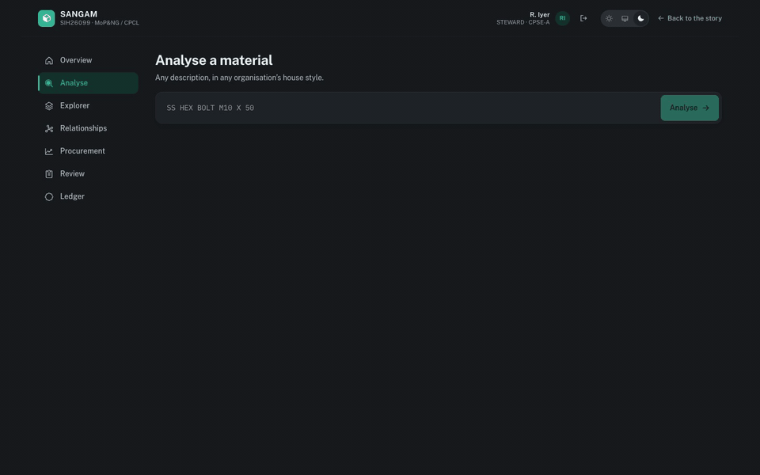

| # | Stage | What happens | Where |
|:-:|---|---|---|
| 1 | **Normalise** | `SS` → `STAINLESS STEEL`, `HEX` → `HEXAGONAL`, glued tokens split (`SCH40` → `SCH 40`) | [`normalise/text.py`](src/nmc/normalise/text.py) · gazetteer `gaz-v2` |
| 2 | **Classify** | Approved item name → family → safety class (`BOLT, MACHINE` → fastener → GENERAL) | [`extract/templates.py`](src/nmc/extract/templates.py) |
| 3 | **Extract** | Typed, unit-canonical attributes: material, thread Ø 10 mm, length 50 mm, head style | [`extract/grammar.py`](src/nmc/extract/grammar.py) · `template-v2` |
| 4 | **Retrieve** | Char-4-gram TF-IDF **and** `bge-small-en-v1.5` embeddings, fused by Reciprocal Rank Fusion. It narrows the field but never decides anything | [`match/retrieve.py`](src/nmc/match/retrieve.py) |
| 5 | **Compare** | Three-valued, never boolean: `AGREE` / `DISAGREE` / `UNKNOWN`. Units reconcile through `pint`, so `1/2 INCH` meets `DN15` | [`match/compare.py`](src/nmc/match/compare.py) |
| 6 | **Veto** | A `DISAGREE` on a CRITICAL attribute zeroes the score. An *unstated* critical attribute demotes to `REVIEW_REQUIRED`, because "not stated" is not "different" | [`match/engine.py`](src/nmc/match/engine.py) |
| 7 | **Score** | 12 features → logistic model → isotonic calibration → `MATCH` · `NEAR_MATCH` · `REVIEW_REQUIRED` · `DISTINCT` | [`ml/model.py`](src/nmc/ml/model.py) |

<details>
<summary><b>Full trace of <code>MS HEX BOLT M10 X 75</code></b> (click to expand)</summary>
<br>

```text
input        MS HEX BOLT M10 X 75
normalised   MILD STEEL HEXAGONAL BOLT M10 X 75                    gaz-v2
item name    BOLT, MACHINE   family fastener   class GENERAL       template-v2
attributes   MATERIAL=MILD_STEEL  THREAD_DIA=10 mm  LENGTH=75 mm  HEAD_STYLE=HEXAGONAL

candidate                         text    decision   because
BOLT HEX MS M10 X 75 MM           0.986   MATCH 1.000
BOLT HEX MS M10*75                0.990   MATCH 0.975
MS HEX BOLT M10 X 75 GR A2-70     0.974   MATCH 0.971
MS HEX BOLT M12 X 75              0.990   DISTINCT    Nominal thread diameter: 10 mm vs 12 mm
CS HEX BOLT M10X75                0.963   DISTINCT    Material: MILD_STEEL vs CARBON_STEEL, disjoint
MS HEX BOLT M10 X 50              0.971   DISTINCT    Length: 75 mm vs 50 mm, tolerance 0.5 mm
```

Every vetoed candidate returns its arithmetic (`w_attr · attr + w_text · text = raw`, then `× veto 0 = 0.0`)
and the full evidence table, so a reviewer can see exactly which attribute refused the merge.

</details>

<br>

## Measured, not claimed

<table>
<tr>
<td align="center" width="25%"><h2>96.67%</h2><sub>retrieval <b>recall@1</b></sub></td>
<td align="center" width="25%"><h2>99.81%</h2><sub><b>MATCH precision</b>, whole engine</sub></td>
<td align="center" width="25%"><h2>0.9997</h2><sub>scorer <b>ROC AUC</b>, held-out test</sub></td>
<td align="center" width="25%"><h2>17.6 ms</h2><sub><b>p95 latency</b> per decision</sub></td>
</tr>
<tr>
<td align="center"><h2>0.0102</h2><sub><b>calibration error</b> (ECE), down from 0.0966</sub></td>
<td align="center"><h2>0</h2><sub><b>false positives</b> on 4,320 test pairs</sub></td>
<td align="center"><h2>2,392</h2><sub>look-alike pairs <b>vetoed</b>, all ≥ 0.85 similar</sub></td>
<td align="center"><h2>71</h2><sub><b>tests</b> passing · 39 endpoints · 12 tables</sub></td>
</tr>
</table>

> [!NOTE]
> These are measured by [`scripts/evaluate.py`](scripts/evaluate.py) and [`scripts/train_scorer.py`](scripts/train_scorer.py)
> on the **synthetic demonstration corpus**, where labels are correct by construction. No real CPSE material master
> is public and none was used. The numbers describe this engine on this corpus, and would have to be re-earned on real data.

<br>

## Platform tour

Ten screens, one engine, every screen in light and dark. Click any image for full size.

<table>
<tr>
<td width="50%">
<picture><source media="(prefers-color-scheme: dark)" srcset=".github/assets/screens/home-dark.png">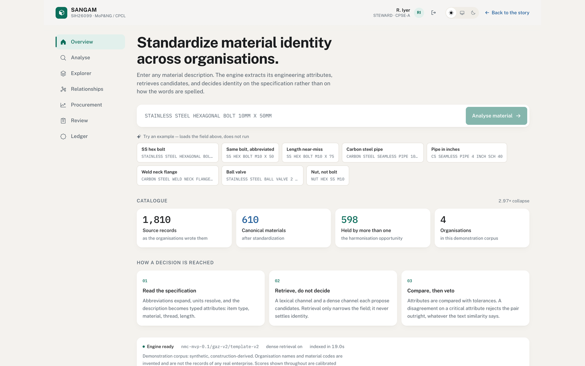</picture>
<p align="center"><b>Overview</b><br><sub>1,810 records collapse to 610 identities (2.97×), and 598 are held by more than one organisation</sub></p>
</td>
<td width="50%">
<picture><source media="(prefers-color-scheme: dark)" srcset=".github/assets/screens/analyse-dark.png">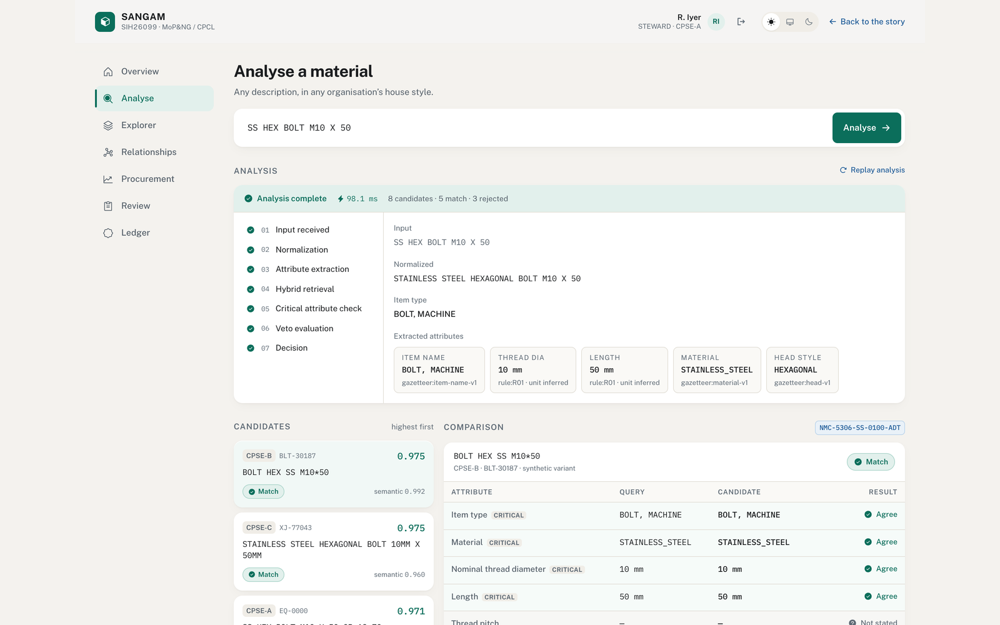</picture>
<p align="center"><b>Analyse</b><br><sub>The seven-stage pipeline, attribute evidence, the arithmetic behind every score</sub></p>
</td>
</tr>
<tr>
<td>
<picture><source media="(prefers-color-scheme: dark)" srcset=".github/assets/screens/visualization-dark.png">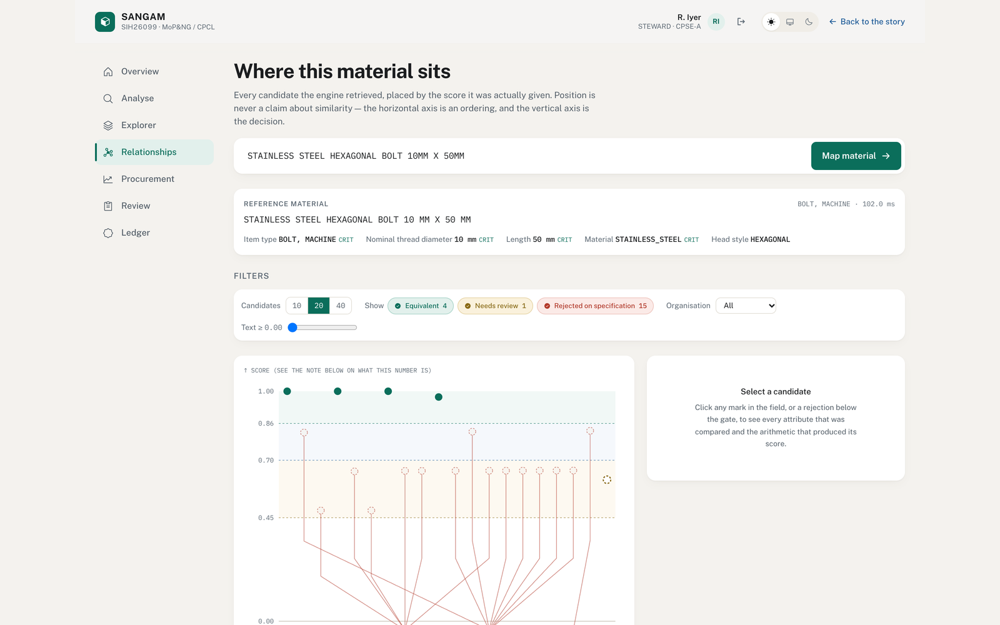</picture>
<p align="center"><b>Relationships</b><br><sub>Every candidate placed by the score it was actually given, with rejections drawn below the gate</sub></p>
</td>
<td>
<picture><source media="(prefers-color-scheme: dark)" srcset=".github/assets/screens/procurement-dark.png">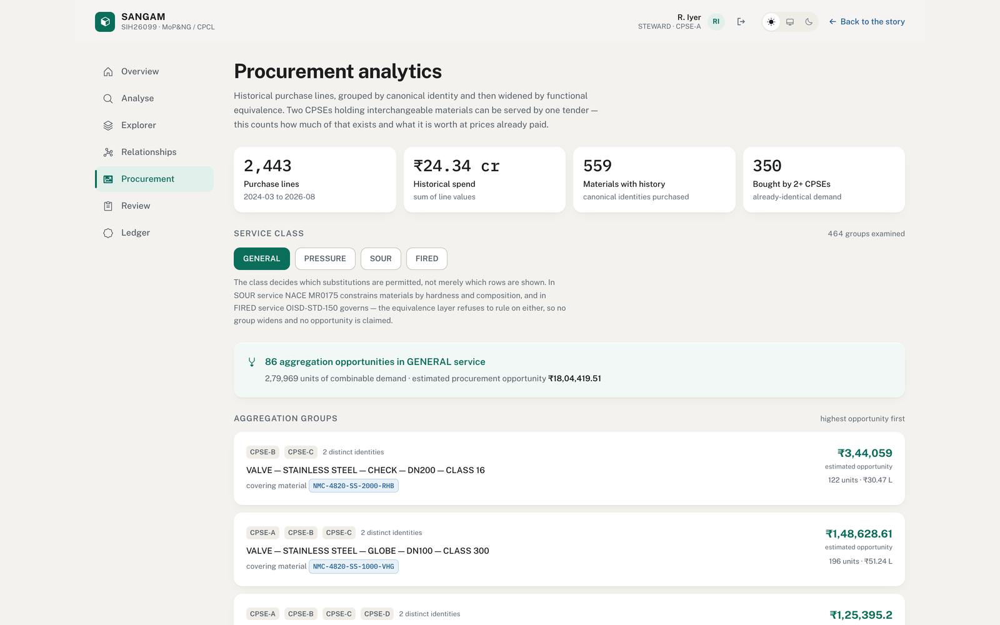</picture>
<p align="center"><b>Procurement</b><br><sub>₹24.34 cr of purchase history regrouped by identity and equivalence into 86 aggregation opportunities</sub></p>
</td>
</tr>
<tr>
<td>
<picture><source media="(prefers-color-scheme: dark)" srcset=".github/assets/screens/review-dark.png">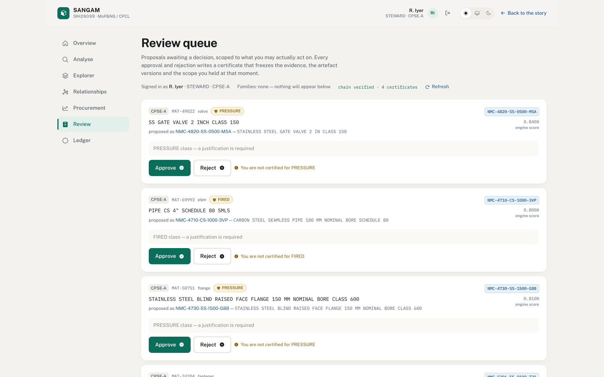</picture>
<p align="center"><b>Review queue</b><br><sub>Scoped to what you may act on. PRESSURE, SOUR and FIRED classes need a named certification</sub></p>
</td>
<td>
<picture><source media="(prefers-color-scheme: dark)" srcset=".github/assets/screens/ledger-dark.png">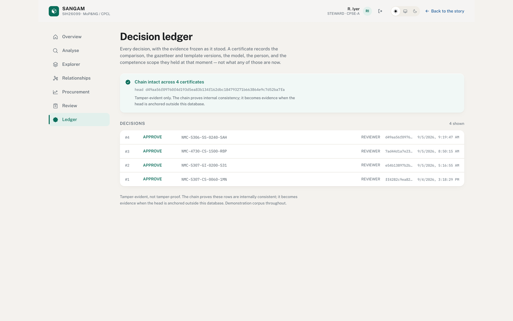</picture>
<p align="center"><b>Decision ledger</b><br><sub>Hash-chained certificates that freeze the evidence, versions and scope at the moment of signing</sub></p>
</td>
</tr>
</table>

<details>
<summary><b>What each of the 11 problem-statement requirements maps to</b> (9 implemented · 2 partial · 0 absent)</summary>
<br>

| # | Requirement | SANGAM capability | Status |
|:-:|---|---|---|
| 1 | AI matching of descriptions **and specifications** | Hybrid retrieval + attribute-gated, calibrated scoring | ✅ Implemented |
| 2 | Duplicate / near-duplicate / equivalent detection | `MATCH` · `NEAR_MATCH` · `REVIEW` · `DISTINCT`, plus a separate functional-equivalence relation | ✅ Implemented |
| 3 | Automated standardization of descriptions | Generated standard description, one per identity | ✅ Implemented |
| 4 | Intelligent classification | Item name → family → safety class | ✅ Implemented |
| 5 | Common national material code | FSC-structured NMC with an offline check character | ✅ Implemented |
| 6 | Map CPSE codes to the national code, keep traceability | Effective-dated mappings; the original code is never overwritten | ✅ Implemented |
| 7 | Legacy rationalization and migration | Supersession + as-of queries | 🟡 Partial: data model complete, no bulk migration tooling |
| 8 | Validation and approval workflow | Scoped review queue, four roles | ✅ Implemented |
| 9 | Analytics and duplicate-detection dashboard | Overview, Explorer, Relationships, Procurement | ✅ Implemented |
| 10 | Audit trail and governance | Hash-chained decision certificates | ✅ Implemented |
| 11 | SAP / ERP integration | Declared schemas mapped to SAP MM fields, CSV in and out | 🟡 Partial: integration-*ready*, no live connector |

The complete, line-by-line self-audit (what exists, what is partial, what is not built) is in [`SANGAM_desc.md`](SANGAM_desc.md).

</details>

<br>

## Architecture

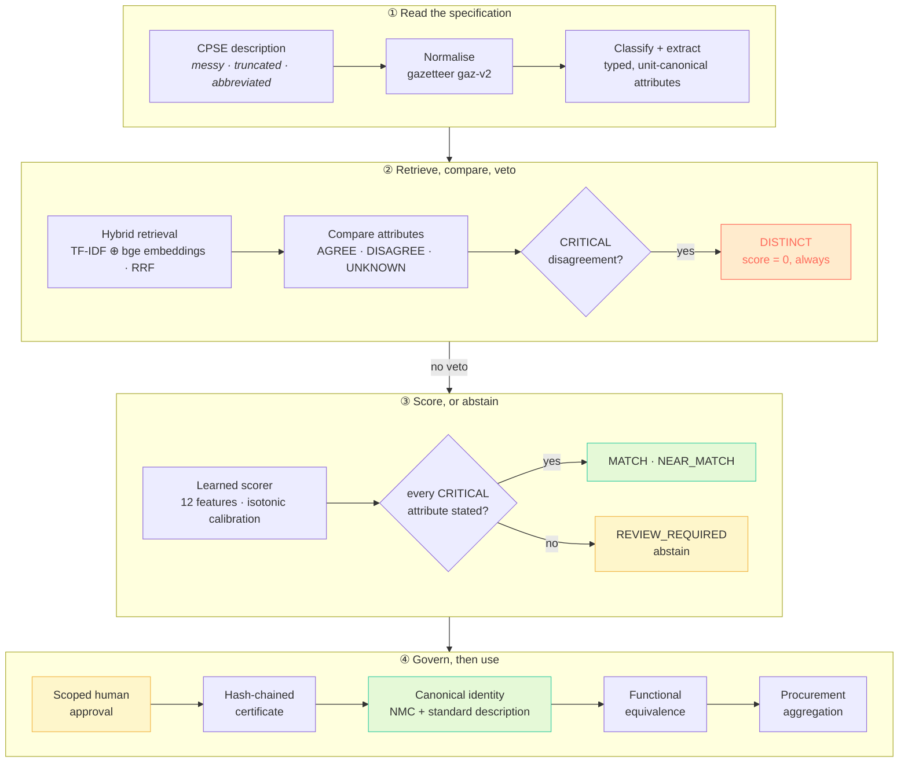

<details>
<summary><b>How the pieces run</b>: two processes, one database, no separate ML service</summary>
<br>

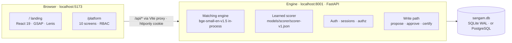

The browser only ever talks to one origin: Vite proxies `/api` to the engine, so the session cookie is
same-origin on localhost *and* through a forwarded port, with no CORS configuration.

</details>

<details>
<summary><b>The decision lifecycle</b>: from a typed description to a signed certificate</summary>
<br>

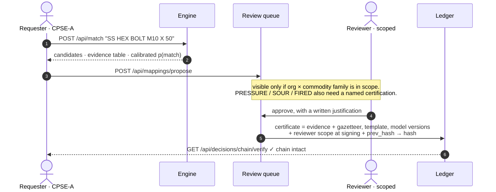

</details>

### The national material code

```text
NMC-5306-SS-0100-ADT
    │    │  │    └─────  discriminator + check char   blake2s over every attribute
    │    │  └──────────  primary dimension, 0.1 mm    0100 = 10.0 mm
    │    └─────────────  material class               SS   = stainless steel
    └──────────────────  Federal Supply Class (NATO)  5306 = Bolts
```

Deterministic (a pure function of the attributes, with no counter and no database lookup), readable on paper, and
**validatable offline**: a position-weighted check character over a Crockford-style alphabet catches a mistyped code
without a round trip. The FSC values are real NATO classes, the same spine India's National Codification Bureau
already uses, so a government reviewer already knows how to read it. → [`standard/codes.py`](src/nmc/standard/codes.py)

### Authority is a pair, never a role

| Account | Role | May act on |
|---|---|---|
| `requester.a@sangam.gov.in` | REQUESTER | propose only |
| `reviewer.a@sangam.gov.in` | REVIEWER | CPSE-A × fastener, pipe, flange · **certified PRESSURE** |
| `reviewer.b@sangam.gov.in` | REVIEWER | CPSE-B × fastener |
| `steward@sangam.gov.in` | STEWARD | CPSE-A × every family |
| `admin@sangam.gov.in` | ADMIN | users and organisations, and **still not another CPSE's master** |

`ADMIN` is deliberately not exempt from organisation scope: an administrator who could silently rewrite another CPSE's
material master is exactly what would stop CPSEs from joining. Cross-organisation change goes through a proposal,
never through privilege. → [`authz.py`](src/nmc/authz.py)

<br>

## The machine learning, honestly

There are **two** models, and keeping them apart is the point:

| | Retrieval embedding | Decision scorer |
|---|---|---|
| **Model** | `BAAI/bge-small-en-v1.5` | Logistic regression + isotonic calibrator |
| **Trained by us?** | No. Downloaded frozen, never fine-tuned | **Yes**, on [`datasets/training/`](datasets/training/) |
| **Job** | Propose candidates | Turn evidence into a calibrated probability |
| **Can it decide identity?** | Never | Never alone, and it cannot overrule the veto |

```math
p(\text{match}) = v \cdot \mathrm{iso}\big(\sigma(\mathbf{w}^{\top}\mathbf{x} + b)\big),
\qquad v = \begin{cases} 0 & \text{if a CRITICAL attribute disagrees} \\ 1 & \text{otherwise} \end{cases}
```

The veto $v$ multiplies **last** and is **not one of the twelve features**, so no weight can learn to outvote it.

<details>
<summary><b>Learned coefficients</b>: what the model actually weighs</summary>
<br>

| Feature | Coefficient | Reading |
|---|---:|---|
| `attribute_agreement` | **+11.57** | the specification signal dominates, as designed |
| `frac_disagree` | **−9.84** | every disagreeing attribute is strong evidence against |
| `frac_agree` | +5.22 | |
| `frac_unknown` | +4.60 | unstated is *not* treated as different |
| `text_gap` | +1.36 | the two text channels disagreeing is itself informative |
| `crit_known_frac` | +1.04 | more of the discriminating set stated, more confidence |
| `lexical` | −0.60 | spelling similarity alone is mildly *distrusted* |
| `text_max` | +0.54 | text is a minor voice |
| `semantic` | +0.32 | |
| `n_rows` · `same_item_name` · `crit_agree_frac` | ≈ 0 | |
| *(intercept)* | −15.15 | |

Bands, with precision realised on the validation split: **MATCH** ≥ 0.90 (99.34%) · **NEAR_MATCH** ≥ 0.70 (98.74%) · **REVIEW** ≥ 0.40 (97.69%).

</details>

| Held-out test · 4,320 pairs | Learned | Hand-tuned formula |
|---|---:|---:|
| Precision | **100.00%** | 99.54% |
| ROC AUC | **0.9997** | 0.9937 |
| Brier score | **0.0038** | 0.0837 |
| Calibration error (ECE) | **0.0102** | 0.0966 |
| Recall at the MATCH band | 96.63% | 98.77% |

Recall is lower **by design**: 7.4% of true matches moved from *auto-assert* to *a person confirms*, while
false positives went to **zero**, and 98.77% of true matches still reach a human or better.

Clean synthetic data is saturated, so the model was also stress-tested by deleting words from descriptions on purpose,
the way real entries get truncated. **Bars: hand-tuned formula · line: learned scorer.**

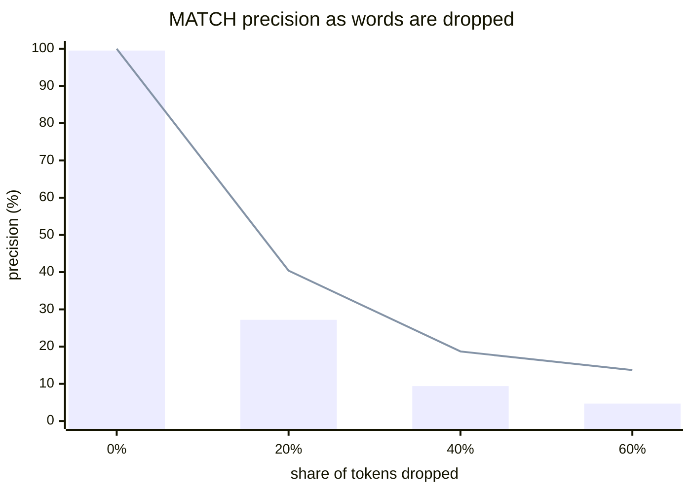

At 40% dropout the hand-tuned formula asserts MATCH at 9.4% precision **while staying confident** (ECE 0.865).
**The old scorer fails dangerously; the learned one fails safely.**

<br>

## Data

Everything the system learns from or stands on, with where it came from.

| | What | Where | Real? |
|---|---|---|---|
| **ML training set** | 1,800 records · 21,600 labelled pairs · 12 features · identity-level split | [`datasets/training/`](datasets/training/) (in git) | Synthetic, labels correct by construction |
| **Fitted scorer** | Coefficients, calibrator, thresholds, evaluation report | [`models/scorer/`](models/scorer/) (in git) | Trained here |
| **Database** | Schema for 12 tables + a clean seeded snapshot | [`db/`](db/) (in git) | Synthetic organisations |
| **Reference catalogue** | DLA FLIS / PUB LOG: ~80k approved item names, attribute dictionaries, 6.9M class × name rows | `data-v1` release → [`scripts/fetch_data.sh`](scripts/fetch_data.sh) | **Real**, US public domain |
| **Realism check** | GSA NSN extract, 12,454 real prose descriptions | `data-v1` release | **Real**, CC0 |

The training set is the exact split behind the shipped model; row counts match [`report.json`](models/scorer/report.json).
Organisations and material codes in it are invented and must never be presented as real CPSE data.
Datasheet: [`datasets/README.md`](datasets/README.md) · licences and provenance: [`docs/DATA_PROVENANCE.md`](docs/DATA_PROVENANCE.md).

<details>
<summary><b>Entity–relationship diagram</b></summary>
<br>

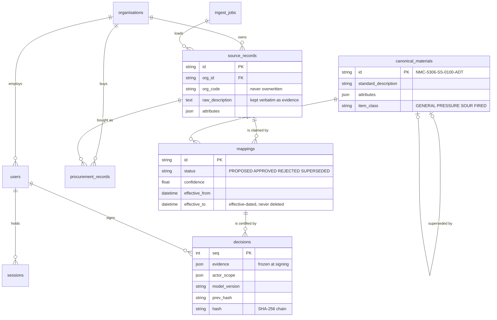

</details>

<br>

## Quickstart

**Needs:** Python 3.12 · Node 20.19+ · ~2 GB free for PyTorch.

```bash
git clone https://github.com/moulishk2205/SANGAM.git
cd SANGAM
```

**Terminal 1: the engine** (API on `:8001`)

```bash
python3.12 -m venv .venv && source .venv/bin/activate
pip install -r requirements.txt
python -m uvicorn src.nmc.api:app --port 8001
```

**Terminal 2: the web app** (on `:5173`)

```bash
cd web && npm install && npm run dev
```

Open **http://localhost:5173** for the landing page and **http://localhost:5173/platform** for the platform.
Pick any demo account on the sign-in screen; the password for all of them is `sangam-demo`.

> [!TIP]
> On first start the engine creates and seeds `sangam.db`, then downloads `bge-small-en-v1.5` (~130 MB) from Hugging Face
> if `models/bge-small-en-v1.5/` is absent. No API keys, no accounts, no network after that. Start it from the
> repository root: the model path is relative.

<details>
<summary><b>More commands</b></summary>
<br>

| Command | Does |
|---|---|
| `pytest` | Runs the 71 tests |
| `python scripts/evaluate.py` | Whole-engine evaluation: extraction, retrieval recall@k, decision quality, veto audit, latency |
| `python scripts/train_scorer.py` | Rebuilds the corpus, retrains and recalibrates the scorer, prints the full report |
| `python scripts/export_training_data.py` | Regenerates `datasets/training/` bit-for-bit |
| `scripts/fetch_data.sh [--all]` | Restores the real FLIS / GSA reference data from the `data-v1` release, SHA-256 verified |
| `python scripts/slice_flis.py` | Streams the FLIS archives down to the demo commodity families |
| `cd web && npm run build` | Production build of the front end |

VS Code users: **Terminal → Run Task → "SANGAM: start everything"** starts both servers.
The full walkthrough is in [`docs/STARTUP.md`](docs/STARTUP.md).

</details>

<details>
<summary><b>Repository map</b></summary>
<br>

```text
SANGAM/
├── src/nmc/                  the engine (Python · FastAPI)
│   ├── api.py                39 endpoints, startup seeding, index build
│   ├── normalise/            gazetteer: abbreviations, units, glued tokens
│   ├── extract/              item-name templates and the attribute grammar
│   ├── match/                retrieve (TF-IDF + embeddings, RRF) · compare · engine
│   ├── ml/                   dataset · features · model · train · metrics · robustness
│   ├── standard/             national material code + standard description
│   ├── equivalence.py        functional equivalence: four verdicts, three rules
│   ├── procure.py            procurement aggregation
│   ├── relate.py             relationship map
│   ├── service.py            the write path: propose · approve · certify
│   ├── authz.py              roles, scopes, class certification, PBKDF2
│   ├── integration/          SAP MM field-mapped schemas, CSV in and out
│   └── db/                   SQLAlchemy models, session, seed
├── web/                      React 19 · Vite 8 · TypeScript · Tailwind 4
│   ├── src/sections/         the cinematic landing page
│   └── src/app/screens/      the ten platform screens
├── models/scorer/            the fitted scorer (17 KB of named coefficients) + report
├── datasets/training/        the ML training set, as CSV
├── db/                       schema.sql + a clean seeded snapshot
├── migrations/               Alembic
├── scripts/                  fetch · slice · train · evaluate · export
├── tests/                    71 tests
└── docs/                     phase-0 plan, research, provenance, startup guide
```

</details>

<br>

## Spin the part

The bolt that runs through every example above, `NMC-5306-SS-0100-ADT`, is an M10 × 50 hex bolt, modelled here to ISO 4014 proportions.
**[Open it in GitHub's 3D viewer →](.github/assets/m10x50-hex-bolt.stl)** Drag to rotate it, scroll to zoom.

<br>

<div align="center">

**SANGAM** (संगम) means *confluence*: the place where rivers meet without any of them ceasing to exist.<br>
Many organisations' material streams joining into one identity, every original code still intact.

<sub>Built by <a href="https://github.com/moulishk2205"><b>Chandramoulishwarar</b></a> for Smart India Hackathon 2026 · problem statement SIH26099</sub>

</div>
