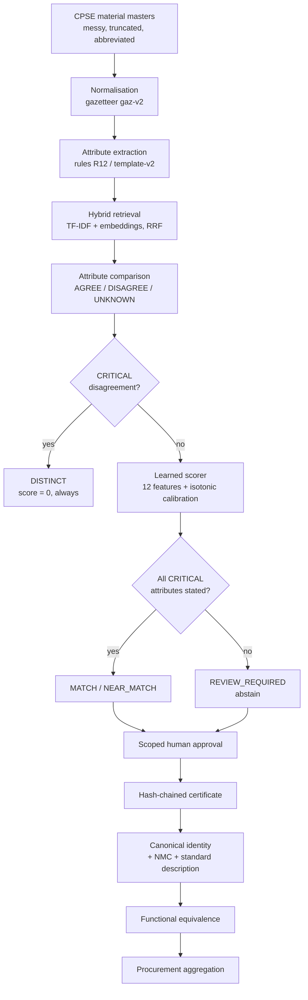
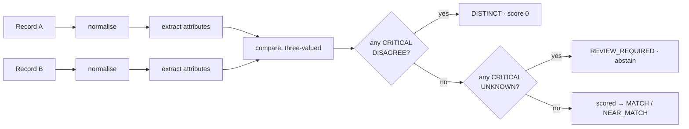
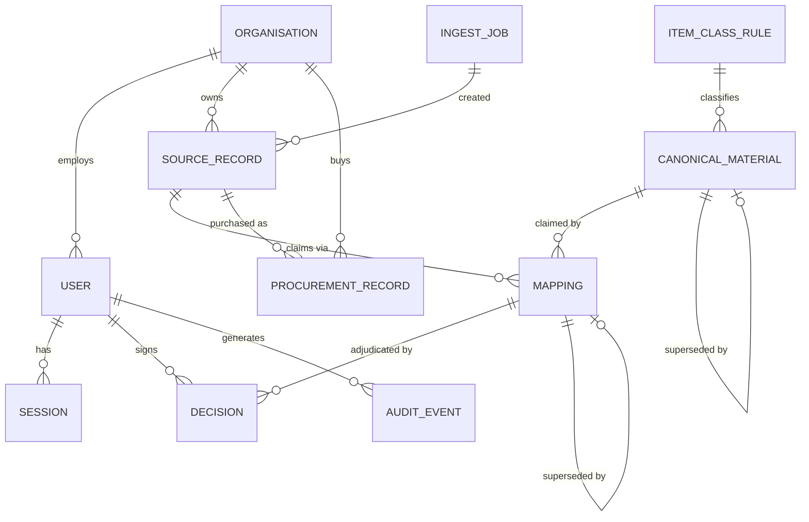
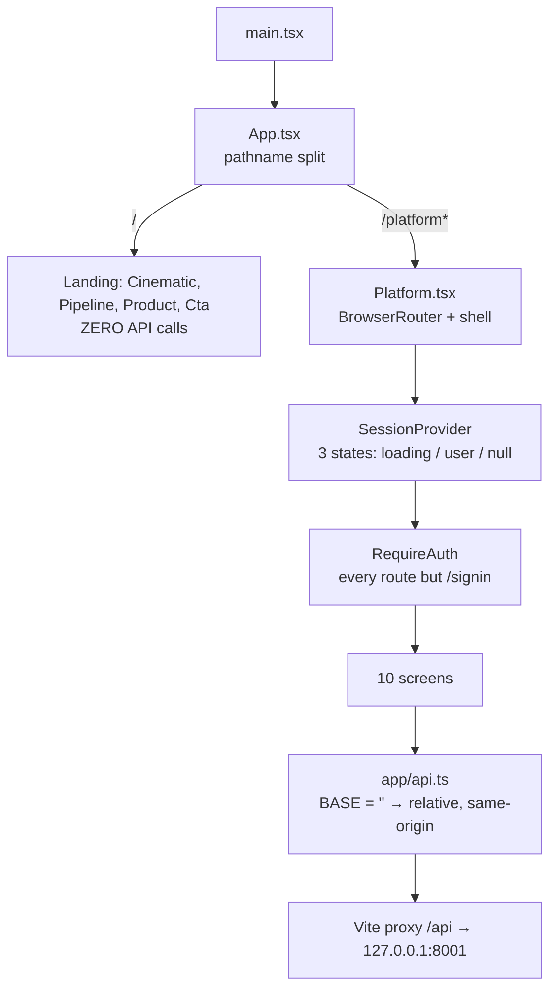
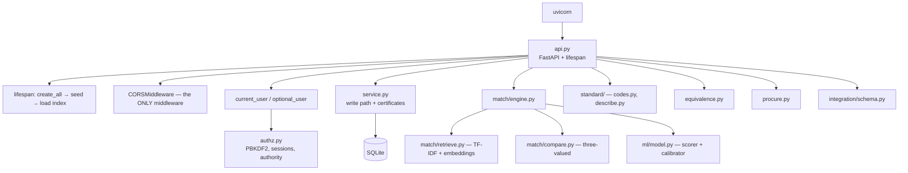
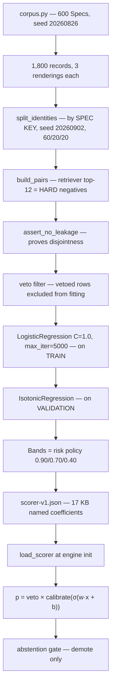
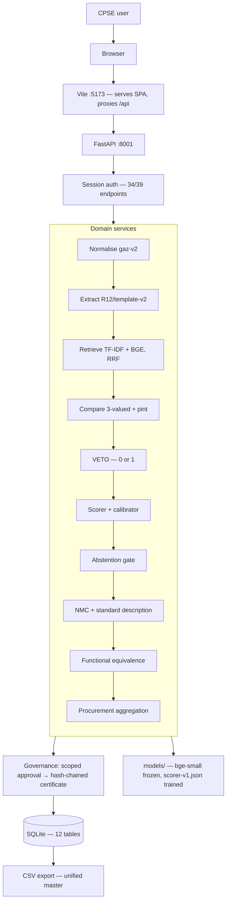
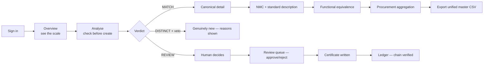

# SANGAM — Complete Platform Self-Audit

**Document type:** self-audit, not marketing.
**Generated:** 2026-09-04, verified against commit `8f606bc`.
**Method:** every claim below was checked by running the code, querying the
database, or reading the file named beside it. Where something could not be
verified it is marked `NOT VERIFIED` or `NOT IMPLEMENTED` rather than described
optimistically.

Three labels are used throughout and never mixed:

| Label | Meaning |
|---|---|
| **IMPLEMENTED** | exists and works end-to-end |
| **PARTIAL** | exists with a stated limitation |
| **NOT IMPLEMENTED** | does not exist in this repository |

---

## 0. Executive Summary

SANGAM resolves the same physical material, written differently by different
Central Public Sector Enterprises, to **one national identity** — while keeping
every organisation's original code, making a named person accountable for each
decision, and recording that decision in a tamper-evident chain.

It is built on a single constraint:

> **Semantic similarity proposes candidates. Structured engineering attributes
> decide identity. A mismatch on a discriminating attribute is a hard veto, not
> a score penalty.**

That constraint is measurable. On the demonstration corpus, **2,392 candidate
pairs were vetoed on a critical attribute, and every one of them had text
similarity ≥ 0.85** — pairs a similarity-threshold matcher would have merged
into the national master, each a different physical part.

**What exists today (all verified):**

- A matching engine: recall@1 **96.67%**, MATCH precision **99.81%**, p95 latency **17.6 ms**
- A trained decision model: 12 features, **21,600 labelled pairs**, test AUC **0.9997**, calibration error **0.0102**
- **12** database tables, **39** API endpoints, **10** platform screens, **71** passing tests
- Role-based governance: organisation × commodity family × safety-class certification
- Hash-chained decision certificates
- An intelligent national material code, a generated standard description, functional equivalence, and procurement analytics over **2,443** purchase lines

**What does not exist:** live SAP connectivity, any image/PDF/OCR capability,
any file-upload control in the user interface, and validation against real CPSE
data. Each is stated plainly in the sections below.

---

## 1. Official SIH Problem Statement

### 1.1 Problem Statement Identity

- **ID:** SIH26099
- **Title:** AI Standardization & Harmonization of Material Codes Across CPSEs
- **Ministry:** Ministry of Petroleum & Natural Gas (MoP&NG)
- **Associated organisation:** Chennai Petroleum Corporation Limited (CPCL)
- **Event:** Smart India Hackathon 2026
- **Source in repository:** `docs/phase0-original-brief.md`

### 1.2 Official Text — Background

> Central Public Sector Enterprises (CPSEs) operating in sectors such as Oil &
> Gas, Power, Steel, Mining and Heavy Engineering procure and maintain a large
> number of similar or functionally equivalent materials. However, the same
> material may be assigned different material codes, descriptions,
> specifications, units of measurement and classification across different
> CPSEs.
>
> This results in duplication of material masters, inconsistent descriptions,
> difficulty in identifying equivalent materials, fragmented procurement data,
> higher inventory levels and limited opportunities for collaborative
> procurement.
>
> A unified and intelligent approach is therefore required to standardize,
> harmonize and rationalize material master data across CPSEs.

### 1.3 Official Text — Description

> The proposed solution envisages development of an AI-powered National Unified
> Material Master Framework capable of analysing material codes, descriptions,
> specifications, technical parameters and historical procurement data from
> multiple CPSEs.
>
> The system shall use Artificial Intelligence, Machine Learning and Natural
> Language Processing (NLP) techniques to identify identical, duplicate,
> near-duplicate and functionally equivalent materials across different ERP/SAP
> systems.
>
> The platform should automatically recommend standardized material
> descriptions, specifications, classifications and a Common National Material
> Code, while retaining mapping with the respective CPSE's existing material
> codes.
>
> The system should provide intelligent matching and recommendation
> capabilities, allowing users to review, validate and approve proposed
> mappings. It should also support migration/mapping of legacy material codes
> and seamless integration with existing SAP/ERP systems.

### 1.4 Official Text — Expected Solution (11 capabilities)

1. AI-based matching of material descriptions and specifications across CPSEs
2. Identification of duplicate, near-duplicate and equivalent materials
3. Automated standardization of material descriptions and technical attributes
4. Intelligent classification and categorization of materials
5. Generation/recommendation of a Common National Material Code
6. Mapping of existing CPSE material codes to the common national code
7. Legacy material code rationalization and migration support
8. User validation and approval workflow for AI recommendations
9. Dashboard for material master analytics and duplicate detection
10. Audit trail and governance mechanism for material master changes
11. Integration capability with SAP/ERP systems of participating CPSEs

> The proposed solution should enable 'One Nation – One Material Code' for
> common materials, while maintaining traceability to individual CPSE material
> codes.

### 1.5 Core Problem — Why It Exists

**OUR INTERPRETATION** (clearly separated from the official text above).

The same bolt is written three ways in three organisations:

```
CPSE-A   SS HEX BOLT M10 X 50                          →  MAT-78291
CPSE-B   STAINLESS STEEL HEXAGONAL BOLT 10MM X 50MM    →  BLT-10922
CPSE-C   BOLT HEX SS M10*50                            →  XJ-55291
```

A human engineer sees one material. A database sees three.

**Why the divergence happens — a structural cause, not carelessness.** SAP's
material description field `MAKTX` is hard-limited to **40 characters** and
cannot be extended without modifying a standard SAP domain. Every CPSE on SAP MM
truncates and abbreviates *at the moment of data entry*. The abbreviations the
platform must decode exist because the field was too short to hold the
specification.

**Why conventional approaches are insufficient:**

| Approach | Why it fails |
|---|---|
| Exact string match | `M10 X 50` ≠ `M10*50`. Finds almost nothing. |
| Fuzzy string match | `M10 X 50` and `M10 X 75` are one character apart. Merges different parts. |
| Plain embedding similarity | **Measured in this project:** `SS HEX BOLT M20X50` scored **0.9860** against a query whose correct duplicate scored **0.9604**. The wrong answer ranked higher. |
| Manual cataloguing | Does not scale to millions of records across dozens of CPSEs. |

The failure mode they share is that **all of them treat a discriminating
dimension as a soft signal.** A pure similarity system cannot distinguish "very
similar description" from "same physical part", and in procurement those are not
close — one is a duplicate to eliminate, the other is a wrong component in a
live refinery.

### 1.6 Stakeholders

| Stakeholder | Pain today |
|---|---|
| Cataloguer / material master cell | Searches free text, finds nothing, creates a duplicate |
| Storekeeper | Four bins, four codes, one physical bolt |
| Procurement officer | Cannot see that another CPSE buys the same item |
| Reviewing engineer | Asked to trust a similarity percentage with no evidence |
| Auditor / CAG | "Who merged these codes, on what basis, and when?" |
| MoP&NG / national | Fragmented procurement data, no basis for common sourcing |

### 1.7 Institutional Context (verified by research)

India **already solved this for defence.** The Directorate of Standardisation is
India's National Codification Bureau (**NCB code 72**), codifying defence items
under the NATO Codification System and issuing NATO Stock Numbers.

**There is no civil-sector equivalent for the CPSEs under MoP&NG.** That gap is
precisely what SANGAM proposes to fill — and it is why SANGAM's national code
borrows the NATO Federal Supply Classification spine rather than inventing a
taxonomy (see A7).

---

## 2. Problem → SANGAM Solution Mapping

| PS Requirement | Problem it causes | SANGAM capability | Engine / module | Input | Output | User benefit | Status |
|---|---|---|---|---|---|---|---|
| 1. AI matching of descriptions **and specifications** | Fuzzy match merges different parts | Hybrid retrieval + attribute-gated scoring | `match/retrieve.py`, `match/engine.py`, `ml/model.py` | Free-text description | Ranked candidates + calibrated probability | Finds real duplicates without inventing them | **IMPLEMENTED** |
| 2. Duplicate / near-dup / **equivalent** | Cannot aggregate demand | MATCH / NEAR_MATCH / REVIEW / DISTINCT **plus** a separate equivalence relation | `match/engine.py` + `equivalence.py` | Two records or two canonicals | Verdict + evidence | Distinguishes "same part" from "will do the job" | **IMPLEMENTED** |
| 3. Automated standardization of descriptions | One CPSE's house style becomes national by accident | Generated standard description | `standard/describe.py` | Canonical attributes | `BOLT, MACHINE — STAINLESS STEEL — M10 × 50 — A2-70` | One description per identity, always | **IMPLEMENTED** |
| 4. Intelligent classification | No consistent categorisation | Item name → family → safety class | `extract/templates.py` | Normalised tokens | 10 item names, 6 families, 4 classes | Consistent grouping; scope + safety gating | **IMPLEMENTED** |
| 5. Common National Material Code | Codes carry no meaning | FSC-structured NMC with check character | `standard/codes.py` | Canonical attributes | `NMC-5306-SS-0100-K7Q` | Readable on paper without a lookup | **IMPLEMENTED** |
| 6. Map CPSE codes → national code, retain traceability | CPSEs will not surrender their codes | Effective-dated `Mapping` table | `db/models.py`, `service.py` | Source record + canonical | Supersedable claim; original code never overwritten | Adoption is possible at all | **IMPLEMENTED** |
| 7. Legacy rationalization and migration | History becomes unanswerable | Effective-dating, supersession, as-of query | `service.py`, `/api/material/{id}/as-of` | Record + timestamp | What the code meant on that date | Vintage questions answerable | **PARTIAL** — data model complete, no bulk migration tooling |
| 8. Validation and approval workflow | AI cannot be the accountable party | Scoped review queue, 4 roles | `authz.py`, `Review.tsx` | Proposed mapping | Approval or a verbatim refusal | A named person is accountable | **IMPLEMENTED** |
| 9. Analytics + duplicate-detection dashboard | No visibility | Overview figures, Explorer, Relationships, Procurement | `/api/stats`, `procure.py` | Database | 8 live figures + aggregation | Sees the scale of duplication | **IMPLEMENTED** |
| 10. Audit trail and governance | "Who did this?" unanswerable | Hash-chained decision certificates | `service.py::certify` | Decision | Frozen evidence, versions, scope-at-signing | Survives an audit | **IMPLEMENTED (exceeds)** |
| 11. SAP/ERP integration capability | Cannot receive CPSE data | Declared schemas with SAP field mappings, CSV in/out | `integration/schema.py` | CSV | Validated rows / unified export | A CPSE can feed it today | **PARTIAL** — integration-*ready*, no live connector |

**Coverage: 9 of 11 fully implemented, 2 partial, 0 absent.**

Requirements 7 and 11 are honestly partial and the sections below say exactly
what is missing rather than rounding up.

---

# PART A — COMPLETE PLATFORM FUNCTIONAL AUDIT

## A1. Platform Overview

**SANGAM** (संगम, *confluence* — where rivers meet) is a national material-code
harmonization platform. The name is the product's thesis: many organisations'
material streams joining into one identity without any of them being erased.

### What it fundamentally does

```
Many CPSE material codes  →  one canonical identity  →  one national code
        (preserved)              (evidence-backed)         (classification-derived)
                                        ↓
                          a named person approves it
                                        ↓
                        a tamper-evident certificate records it
                                        ↓
                     procurement demand can finally be aggregated
```

### What makes it different from a material search engine

A search engine ranks by similarity and stops. SANGAM does four things a search
engine does not:

1. **It refuses.** A `DISAGREE` on a CRITICAL attribute zeroes the score — not
   reduces it. `M10×50` and `M10×75` are structurally unable to merge.
2. **It abstains.** If a discriminating attribute is *unstated*, the answer is
   REVIEW_REQUIRED, not a guess. "Not stated" is not "different".
3. **It is accountable.** No mapping becomes fact without a named, scoped human.
4. **It remembers immutably.** Every decision is hash-chained with the evidence
   frozen as it stood.

### Role of each layer

| Layer | Role | Honest limit |
|---|---|---|
| **AI/ML** | Proposes candidates (embeddings) and scores them (trained logistic model + calibrator) | Never decides identity alone; cannot overrule the veto |
| **Canonicalization** | Collapses many source codes to one identity | Only as good as attribute extraction |
| **National code** | Makes identity portable and meaningful on paper | Covers 10 item names today |
| **Procurement analytics** | Converts harmonization into money | Synthetic demonstration data |

### Conceptual architecture



---

## A2. Complete Screen Inventory

**Verified from `web/src/app/Platform.tsx` route table and `web/src/App.tsx`.**

`App.tsx` routes by pathname: anything starting with `/platform` renders the
application; everything else renders the marketing landing page. One bundle, one
server.

| # | Screen | Route | Purpose | Primary user | Main features | Backend | Status |
|---|---|---|---|---|---|---|---|
| 0 | **Landing** | `/` | Explain the problem | Public / judge | Scroll-scrubbed hero, 7-step pipeline, corpus figures | **none — zero API calls** | IMPLEMENTED |
| 1 | **Sign in** | `/platform/signin` | The only door | All | Form + 5 one-click demo accounts | `/api/auth/login` | IMPLEMENTED |
| 2 | **Overview** | `/platform` | Console entry, live figures | All | 8 stats, search box, sample chips | `/api/stats`, `/api/health`, `/api/samples` | IMPLEMENTED |
| 3 | **Analyse** | `/platform/analyse` | The core loop | Cataloguer | 7-stage pipeline, candidates, evidence table | `/api/match` | IMPLEMENTED |
| 4 | **Explorer** | `/platform/explorer` | Browse the catalogue | All | Search, cursor pagination, cards | `/api/canonical` | IMPLEMENTED |
| 5 | **Canonical detail** | `/platform/material/:nmc` | One identity in full | All | Code breakdown, attributes, sources, equivalence | `/api/canonical/{id}`, `/api/equivalence/{id}` | IMPLEMENTED |
| 6 | **Relationships** | `/platform/visualization` | Neighbourhood of a material | Engineer | Relation bands, fidelity verdict | `/api/visualization` | IMPLEMENTED |
| 7 | **Procurement** | `/platform/procurement` | Economic impact | Procurement officer | Figures, service-class selector, aggregation groups, export | `/api/procurement/*`, `/api/integration/export/unified` | IMPLEMENTED |
| 8 | **Review** | `/platform/review` | Accountability | Reviewer / Steward | Scoped queue, approve/reject, chain counter | `/api/review/queue`, `/api/mappings/*` | IMPLEMENTED |
| 9 | **Ledger** | `/platform/ledger` | Every decision | Auditor | Decision list, certificates, chain verification | `/api/decisions*` | IMPLEMENTED |
| 10 | **Account** | `/platform/account` | Your authority | All | Scope, certifications, can/cannot, own decisions | `/api/auth/me`, `/api/decisions` | IMPLEMENTED |
| 11 | **Not found** | `*` | Unmatched path | All | Branded 404 (gated — an unknown path should not reveal the deployment) | none | IMPLEMENTED |

**There is no Upload screen, no Settings screen, and no Admin screen.** The
`/api/ingest` endpoint exists but has **no user interface** (see A16, A20).

---

## A3. Screen-by-Screen Audit

### Screen: Sign in

- **Route:** `/platform/signin` · **File:** `web/src/app/screens/SignIn.tsx`
- **Who:** every user. **Problem solved:** nothing is readable without a session.

**What the user sees, top to bottom:**

| Element | Content | Source |
|---|---|---|
| National identity strip | भारत सरकार · Government of India / पेट्रोलियम एवं प्राकृतिक गैस मंत्रालय / Ministry of Petroleum and Natural Gas | **static UI text** |
| Tricolour rule | 3px saffron `#FF9933` / white / green `#138808` | static |
| SANGAM mark | Cube icon + "Material Intelligence · SIH26099" | static |
| Heading | "Authorised sign-in" | static |
| Form | Registered email, Password | user input |
| Restricted-use notice | "All sign-ins, approvals and rejections are recorded…" | static, **and true** |
| Demo account cards | 5 accounts with role, org, scope | **hardcoded `ACCOUNTS` array in SignIn.tsx**, matching `db/seed.py::USERS` |
| Footer | "A student prototype… not endorsed by any Government of India body" | static |

> **Deliberate absence: the State Emblem of India.** Its use is restricted by the
> *State Emblem of India (Prohibition of Improper Use) Act, 2005* to the
> authorities that Act names. A hackathon entry is not one of them. The SANGAM
> cube mark occupies that position instead.

**Buttons:**

```
[Sign in]  (type=submit)
  → onSubmit → go(email, password)
  → useSession().signIn()
  → POST /api/auth/login  {email, password}
  → api.py::login → find_user_by_email → verify_password (PBKDF2-HMAC-SHA256)
  → authz.py::open_session → INSERT sessions
  → Set-Cookie: sangam_session (HttpOnly, SameSite per request, Max-Age 43199)
  → nav(next) — the ?next= destination, validated to start with /platform
  UI becomes: the requested screen, rail visible, user chip in header

[Demo account card × 5]  (Card onClick)
  → identical path with a hardcoded email + DEMO_PASSWORD 'sangam-demo'
```

**States:** error → red inline alert with the server's own message; busy →
"Signing in…"; the header "Sign in" link is hidden while on this screen.

**Status: IMPLEMENTED.**

---

### Screen: Overview

- **Route:** `/platform` · **File:** `screens/Home.tsx`

**Every displayed value and its origin:**

| Displayed | Meaning | Source | Kind |
|---|---|---|---|
| Source records | CPSE codes ingested | `/api/stats` → `COUNT(source_records)` | raw count |
| Canonical materials | Distinct identities | `COUNT(canonical_materials)` | raw count |
| Cross-org materials | Identities held by 2+ CPSEs — **the duplication finding** | SQL subquery over approved mappings joined to source orgs | **derived** |
| Collapse ratio | source ÷ canonical | `service.counts()` | **calculated** |
| Organisations | Participating CPSEs | `COUNT(organisations)` | raw |
| Approved / pending mappings | Adjudication state | `COUNT(mappings) GROUP BY status` | raw |
| Decisions | Certificates written | `COUNT(decisions)` | raw |
| Engine banner | `ready`, `dense_channel`, `model_version`, `calibrated` | `/api/health` | config/state |
| Sample chips | Example queries | `/api/samples` — **filtered server-side** to those the extractor actually classifies | derived |

**Buttons:**

```
[Analyse]  → nav(/platform/analyse?q=<text>)   — client-side only, no API
[sample chip] → setQ(sample) + focus the input — no API
```

**Status: IMPLEMENTED.**

---

### Screen: Analyse — the core loop

Covered in full in **A4**.

---

### Screen: Explorer

- **Route:** `/platform/explorer` · **File:** `screens/Explorer.tsx`

Search box (debounced) → `GET /api/canonical?q=&limit=` → cursor-paginated
(not offset — offset pagination drifts when rows are inserted mid-scan).

Each card shows the **generated standard description** (falling back to
`canonical_text`), the NMC tag, item class, source count and organisation count.
Whole card is a `Link` to the canonical detail.

**Status: IMPLEMENTED.**

---

### Screen: Relationships

- **Route:** `/platform/visualization` · **File:** `screens/Visualize.tsx` (1,061 lines)

Enter a description → `POST /api/visualization` → `relate.py::build_map()`.

Relations are banded: **EQUIVALENT**, **PROBABLE** ("Close — not confirmed"),
**REVIEW**, **SIMILAR**, **REJECTED**.

> **An honesty decision that is visible on this screen.** `relate.py` computes a
> PCA projection (`numpy.linalg.svd`) and then measures whether the 2-D distances
> preserve the true ranking (Spearman, `rank_fidelity()`). Because it was
> measured that embedding distance ranks the *wrong* answer closer than the right
> one, **the scatter is reported as text, never drawn.** `fidelity_verdict()`
> returns USABLE / WEAK / **NOT A DISTANCE MAP**. The platform refuses to draw a
> picture that would mislead.

Candidate-to-candidate edges are deliberately **not** built — only query-to-candidate.

**Buttons:** submit query; top-K selector (5/10/20) re-queries; node click
selects/deselects; group click picks a representative.

**Status: IMPLEMENTED.**

---

### Screen: Review

- **Route:** `/platform/review` · **File:** `screens/Review.tsx`

**The queue is scoped server-side, not filtered client-side.** `api.py::review_queue`
returns only what this reviewer may act on — their organisation, their commodity
families. A queue you cannot clear is not a queue.

| Displayed | Source |
|---|---|
| Org chip, org code, family, item class | `source_records` + `canonical_materials` |
| Description / canonical text | `source_records.raw_description` |
| Confidence (4 dp) + "engine score" | `mappings.confidence` at proposal time |
| `you_may_approve` | `authz.certified_for_class()` evaluated per row |
| Chain counter | `/api/decisions/chain/verify` → `{ok, checked}` |
| Scope line | `/api/auth/me` |

**Buttons:**

```
[Approve]
  → work.approve(mapping_id, note)
  → POST /api/mappings/{id}/approve
  → service.approve()
      1. approver_check(user, family, item_class, org)   ← AUTHORISATION FIRST
      2. class-rule justification check
      3. idempotent state check
      4. UPDATE mappings.status = APPROVED
      5. certify() → hash-chained Decision row
  → card turns green, form hides, chain counter increments
  → on refusal: 403, reason rendered VERBATIM beside the item

[Reject]   same path, service.reject(), requires a note
[Refresh]  re-fetches the queue
[note input] free text → becomes Decision.note on the certificate
```

> **A security bug fixed here and regression-tested.** `approve()` originally
> returned early on the idempotent state check *before* authorising, so a CPSE-B
> reviewer and a REQUESTER both received `200 APPROVED` on a CPSE-A record.
> Authorisation now runs first. Test: `test_approve_checks_authority_before_state`.

**Status: IMPLEMENTED.**

---

### Screen: Ledger

- **Route:** `/platform/ledger` · **File:** `screens/Ledger.tsx`

Chain verification runs on load and **reports whatever it says** — an audit
feature that only reports success is not an audit feature.

| Displayed | Source |
|---|---|
| "Chain intact across N certificates" | `service.verify_chain()` recomputes every hash |
| head hash | `decisions.hash` of the newest row |
| Decision rows | `/api/decisions` — seq, kind, actor role, hash prefix, timestamp |
| Certificate detail | `/api/decisions/{id}` — evidence, versions, scope-at-signing, prev→this hashes |

**Buttons:** a decision row opens its certificate (`GET /api/decisions/{id}`);
`[Close]` clears it. A failed fetch renders an error — it used to be swallowed by
a bare `.catch(() => {})`, which made the row a dead click.

> Wording is deliberately careful and must stay careful: **tamper-evident, never
> tamper-proof.** The chain lives in a database we control, so alone it proves
> internal consistency. It becomes evidence when the head is anchored externally.

**Status: IMPLEMENTED.**

---

### Screen: Account

- **Route:** `/platform/account` · **File:** `screens/Account.tsx`

Exists because of a specific failure: a reviewer clicks Approve, the server
refuses, and the refusal arrives as a surprise. This screen states the authority
model **before** you hit it.

Two columns — **"You may"** and **"The server will refuse"** — both derived in
the browser from `/api/auth/me` (`role`, `org_id`, `commodity_scope`,
`class_certifications`). "Your decisions" filters `/api/decisions` to
`actor_id === user.id`.

**Buttons:** `[Sign out]` → `POST /api/auth/logout` → revokes the session row,
clears the cookie, gate redirects to sign-in.

**Status: IMPLEMENTED.**

---

### Screen: Procurement

Covered in full in **A11**.

---

## A4. Analysis Screen — Deep Technical Trace

**File:** `web/src/app/screens/Analyse.tsx` (563 lines) → `POST /api/match`.

### Worked example: `MS HEX BOLT M10 X 75`

This is the single query that demonstrates the entire architecture. It returns
**8 candidates: 3 matches and 5 rejections.**

**Step 1 — Frontend.** `Analyse.tsx` submits; `api.match(text, 8)` issues
`POST /api/match {description, top_k: 8}` with `credentials: 'include'`.

The seven visible stages are a **presentation of real backend phases**, revealed
as the response arrives. The one deliberate `AnimatePresence mode="wait"` in the
codebase lives here — the pause is the point, showing the engine working.

**Step 2 — Normalise** (`normalise/text.py`, `gaz-v2`):

```
MS HEX BOLT M10 X 75
  → uppercase, strip punctuation
  → gazetteer: MS → MILD STEEL, HEX → HEXAGONAL
  → glue splitters: (?<=\d)(NB|NPS|ND)\b, (?<=\d)["″”], \b(SCH|CL|PN)(\d+)\b
  → "MILD STEEL HEXAGONAL BOLT M10 X 75"
```

**Step 3 — Classify + extract** (`extract/`, rules `R12`, `template-v2`):

```
item_name  = BOLT, MACHINE          (token "BOLT")
family     = fastener
template   = ITEM_NAME, MATERIAL, THREAD_DIA, LENGTH, THREAD_PITCH,
             HEAD_STYLE, GRADE, STANDARD, SURFACE_TREATMENT
extracted  = MATERIAL=MILD_STEEL, THREAD_DIA=10 mm, LENGTH=75 mm,
             HEAD_STYLE=HEXAGONAL
```

> **A bug fixed in this layer that mattered enormously.** The pressure-class
> regex was `\b#\s*(\d{2,4})`. After a space, `\b#` can never match — `#150` was
> never extracted, silently leaving a CRITICAL attribute unstated and
> **un-vetoing pairs that should have been rejected.** The `#` now sits outside
> the leading `\b`.

**Step 4 — Hybrid retrieval** (`match/retrieve.py`), two channels, never averaged:

- **Lexical:** character 4-gram TF-IDF
- **Dense:** `bge-small-en-v1.5` embeddings — **downloaded frozen, never trained**

Fused by **Reciprocal Rank Fusion**, `RRF_K = 60`. RRF because BM25-style scores
are unbounded positives and cosine similarity is in [-1, 1]; averaging two
incompatible scales is meaningless. The dense channel is imported lazily, so a
missing install degrades to lexical-only rather than failing to boot.

**Step 5 — Compare** (`match/compare.py`), **three-valued, never boolean**:

`AGREE` / `DISAGREE` / `UNKNOWN`. Units reconcile through `pint`, so `1/2 INCH`
and `DN15` compare correctly. **"Not stated" is not "different"** — that single
rule is why the engine abstains instead of guessing.

**Step 6 — Score** (`match/engine.py` → `ml/model.py`):

```
p(match) = veto × calibrate(σ(w · x + b))
```

The veto multiplies **last** and is **not one of the twelve features**, so it
cannot be outvoted. A second gate demotes MATCH → REVIEW_REQUIRED whenever a
CRITICAL attribute is unstated on either side.

**Step 7 — Actual measured result:**

| Candidate | Text similarity | Score | Why |
|---|---|---|---|
| `BOLT HEX MS M10 X 75 MM` | 0.9857 | **1.0000** | genuine match |
| `BOLT HEX MS M10*75` | 0.9904 | **0.9750** | genuine match |
| `MS HEX BOLT M10 X 75 GR A2-70` | 0.9737 | **0.9706** | genuine match |
| `MS HEX BOLT M12 X 75` | 0.9898 | **0.0000** | thread Ø 10 vs 12 mm |
| `CS HEX BOLT M10X75` | 0.9631 | **0.0000** | MILD_STEEL vs CARBON_STEEL |
| `MS HEX BOLT M10 X 50` | 0.9711 | **0.0000** | length 75 vs 50 mm |

**Five candidates above 0.96 text similarity, scored exactly zero.** Every one is
a different physical part. A similarity-threshold matcher would have merged all
five into the national master.

**Buttons on this screen:**

```
[Analyse]        → POST /api/match, runs the pipeline above
[Replay analysis]→ doReplay() — re-runs the stage animation, NO new API call
[candidate row]  → setSel(i) — client-side selection, swaps the evidence table
```

**Status: IMPLEMENTED.**

---

## A5. Material Identity

**Identity is a claim that two records denote the same physical part.**

### What constitutes identity

Not the description. The **structured attribute set** extracted from it. Two
records are the same material iff every discriminating attribute agrees.

Attributes carry a **criticality** (`extract/templates.py`):

| Criticality | Meaning | Effect on identity |
|---|---|---|
| `CRITICAL` | Discriminates the part | Disagreement → **hard veto, score 0**. Unstated → abstain |
| `IMPORTANT` | Materially affects fit/function | Contributes to agreement |
| `MINOR` | Useful but not identifying | Contributes weakly |
| `INFORMATIONAL` | Recorded, not scored | No effect |

**The 18 attributes and their criticality (verified):**

`ITEM_NAME`, `MATERIAL`, `THREAD_DIA`, `LENGTH`, `NOMINAL_SIZE`,
`PRESSURE_CLASS`, `BORE`, `PART_NUMBER`, `SCHEDULE`, `VALVE_TYPE`,
`FLANGE_TYPE` → **CRITICAL**
`THREAD_PITCH`, `HEAD_STYLE`, `GRADE`, `FACING`, `CONSTRUCTION` → **IMPORTANT**
`STANDARD`, `SURFACE_TREATMENT` → **MINOR**

### How two records become identical



### Worked examples from the real system

| Pair | Verdict | Reason |
|---|---|---|
| `SS HEX BOLT M10 X 50` vs `STAINLESS STEEL HEXAGONAL BOLT 10MM X 50MM` | **MATCH** | every attribute AGREE; wording irrelevant |
| `SS HEX BOLT M10 X 50` vs `SS HEX BOLT M10 X 75` | **DISTINCT** | LENGTH 50 vs 75 mm — CRITICAL veto |
| `SS HEX BOLT M10 X 50` vs `MS HEX BOLT M10 X 50` | **DISTINCT** | MATERIAL disjoint — CRITICAL veto |
| `SS HEX BOLT M10 X 50` vs `SS HEX BOLT` | **REVIEW_REQUIRED** | THREAD_DIA and LENGTH unstated — abstain, do not guess |

> **The last row is a regression test.** The learned scorer once asserted MATCH
> at **p = 0.97** on that pair, because agreement is computed over what *both*
> sides state and a description that states almost nothing agrees with almost
> everything. The training corpus always states its criticals, so the model never
> met the case. The fix is a **rule, not more data** — the abstention gate now
> applies to the learned path too, and can only demote. Test:
> `test_learned_path_still_abstains_on_unstated_criticals`.

### ML versus deterministic rules — the exact division

| Decided by | What |
|---|---|
| **Deterministic rules** | normalisation, attribute extraction, unit comparison, **the veto**, the abstention gate |
| **ML (frozen)** | candidate *retrieval* — the dense channel |
| **ML (trained)** | the *score* within the non-vetoed space, and its calibration |

**The model can never create a match the rules forbid.** It ranks inside a space
the rules have already fenced.

### What confidence means, and what happens when it is low

With the fitted scorer loaded, confidence is a **calibrated probability** —
measured ECE **0.0102**, so "0.9" genuinely means "right about nine times in
ten". Bands are risk policy, not fitted: **MATCH 0.90 / NEAR 0.70 / REVIEW 0.40**.

Low confidence does not produce a wrong answer; it produces a **routed** one.
Measured on the held-out test split: 96.6% auto-assert, 0.9% to human
confirmation, 1.2% to review — **98.77% reaches a human or better.**

---

## A6. The Canonical Page

### What canonicalization is

Collapsing many organisation-specific records that denote the same physical part
into **one identity**, with the originals preserved.

### Why SANGAM needs it

Because the PS requires "One Nation – One Material Code **while maintaining
traceability to individual CPSE material codes**." Canonicalization is the
mechanism: the canonical is the national identity, the `Mapping` rows are the
traceability, and no CPSE code is ever overwritten.

### What is preserved, normalised, generated, discarded

| Fate | What | Where |
|---|---|---|
| **Preserved, never edited** | `raw_description`, `org_code`, `org_id`, `provenance` | `source_records` |
| **Normalised** | text (gazetteer), units (pint), material vocabulary | derived at ingest |
| **Generated** | NMC, standard description, family, item class | `standard/`, `templates.py` |
| **Discarded** | nothing | — |

That last row matters: **SANGAM discards nothing.** Mappings are effective-dated
and supersedable; `effective_to` closes and a new row opens.

### Every element on the canonical page and its source

**File:** `screens/Canonical.tsx` · **API:** `GET /api/canonical/{nmc_id}`

| Element | Meaning | Source | Kind |
|---|---|---|---|
| NMC tag | The national code | `canonical_materials.id` | generated |
| Item name | Standardised type | `.item_name` | classified |
| **Standard description** (lead) | Procurement-facing text | `.standard_description` ← `standard/describe.py` | **generated** |
| "indexed as: …" | What the matcher indexed | `.canonical_text` | derived from a member record |
| **Code breakdown panel** | FSC / Material / Size / Discriminator / Check | `standard/codes.py::describe_nmc()` — **no DB lookup** | derived from the code string |
| "check character verified" | Offline validity | `validate_nmc()` | computed |
| Canonical attributes | The identity-defining set | `.attributes` (JSON) | extracted |
| Item class + rule | Safety class and its basis | `item_class_rules` | configuration |
| Source traceability | Every CPSE code mapped here | `mappings ⋈ source_records` | raw |
| **Functional equivalence panel** | Substitutable materials | `GET /api/equivalence/{id}` | **computed on demand** |

**Buttons:** service-class selector (GENERAL / PRESSURE / SOUR / FIRED) re-queries
equivalence; equivalent-material links navigate; "All materials" returns to Explorer.

**Status: IMPLEMENTED.**

---

## A7. National Material Code (NMC)

### What it is

```
NMC-5306-SS-0100-K7Q
    │    │  │    │└─ check character
    │    │  │    └── discriminator (2)
    │    │  └─────── primary dimension, tenths of a millimetre
    │    └────────── material class
    └─────────────── NATO Federal Supply Classification
```

**File:** `src/nmc/standard/codes.py` · version `nmc-code-v2`

### What was wrong before

`NMC-00022499` — a serial. Unique, stable, and it told a procurement officer
nothing. Two codes one apart could be a bolt and a pipe flange, and no part of
the string could be checked without a database round trip.

### The FSC values are real

**5306 Bolts · 5305 Screws · 5310 Nuts and Washers · 5307 Studs ·
3110 Bearings, Antifriction · 4820 Valves, Nonpowered · 5330 Packing and Gasket
Materials · 4730 Pipe Fittings · 4710 Pipe and Rigid Tubing · 9999 Unclassified**

These are genuine NATO Federal Supply Classification codes, not invented. That is
deliberate: India's Directorate of Standardisation is the National Codification
Bureau (NCB 72) and already codifies defence items under NCS. **A civil national
code that borrows the same class spine is one a government reviewer already knows
how to read**, and it extends to ~600 FSCs rather than a taxonomy we made up.

Unmapped item names fall to `9999` — an admitted gap is better than an invented
class that looks authoritative and is not.

### Properties (each verified by test)

| Property | How | Test |
|---|---|---|
| Deterministic | pure function of attributes; no counter, no DB | `test_code_is_deterministic` |
| Meaningful | family/material/size readable without lookup | `test_code_carries_classification` |
| Validatable offline | position-weighted check char over Crockford-style alphabet (no I, L, O, U) | `test_code_validates_and_catches_a_typo` |
| Collision-free in practice | discriminator = blake2s over the full attribute set | `test_different_materials_get_different_codes` |
| Backward compatible | legacy `NMC-\d{8}` still validates, flagged `legacy` | `test_legacy_code_still_validates` |

Collisions are resolved **against storage** in `db/seed.py` (only storage knows
what exists); the generator itself stays pure.

**Status: IMPLEMENTED.**

---

## A8. Standard Description

**File:** `src/nmc/standard/describe.py`

### Why it was necessary

The canonical text used to be inherited from whichever member record sorted
first. So the national description for a material was, in effect, **one CPSE's
house style promoted to national status by an accident of sort order** — and two
identical materials discovered in a different order would have been described
differently.

### The generated form

```
BOLT, MACHINE — STAINLESS STEEL — HEXAGONAL — M10 × 50 — A2-70 — IS 1364
```

| Fragment | Generated from | Rule |
|---|---|---|
| `BOLT, MACHINE` | `item_name` | classified type, always first |
| `STAINLESS STEEL` | `MATERIAL` | `MATERIAL_TEXT` map: storage `STAINLESS_STEEL` → printed form |
| `HEXAGONAL` | `HEAD_STYLE` | underscores → spaces |
| `M10 × 50` | `THREAD_DIA` + `LENGTH` | **folded into one fragment** — an engineer reads thread and length as one dimension |
| `A2-70` | `GRADE` | verbatim |
| `IS 1364` | `STANDARD` | verbatim |
| `DN100` / `CLASS 150` / `SCH 40` | `NOMINAL_SIZE` / `PRESSURE_CLASS` / `SCHEDULE` | prefixed forms |

**Fixed print order** (`_PRINT_ORDER`), filtered to the item's own template.
Missing attributes are **omitted**, never printed as an empty segment — a gap
reads as a value nobody filled in.

**The guarantee:** the same canonical attribute set always yields the same
string, whatever the source records said. Verified by
`test_description_is_deterministic_and_source_independent`, which reorders the
attribute dictionary and asserts an identical result.

**Status: IMPLEMENTED.**

---

## A9. Functional Equivalence

**File:** `src/nmc/equivalence.py` · version `equiv-v1`

### Identity versus equivalence — the distinction that unlocks the money

```
IDENTITY            M10×50 A2-70  ≠  M10×50 A4-80     (DISTINCT — correct)
FUNCTIONAL EQUIV.   M10×50 A2-70  ↔  M10×50 A4-80     (interchangeable in GENERAL service)
```

The matcher is **right** to call them distinct — they are different materials
with different national codes. But procurement does not buy identities, it buys
things that will do the job. If CPSE-A needs 10,000 A2-70 and CPSE-B needs 15,000
A4-80, **one tender for 25,000 A4-80 satisfies both**, because A4-80 covers
everything A2-70 does.

This module never touches `engine.py`, never adjusts a threshold, and never
produces a MATCH.

### The four verdicts

`IDENTICAL` · `FUNCTIONALLY_EQUIVALENT` · `NOT_EQUIVALENT` · `UNDETERMINED`

### The three rules that keep it honest

**1. Interface attributes must match EXACTLY, never approximately.**

`ITEM_NAME, THREAD_DIA, THREAD_PITCH, LENGTH, NOMINAL_SIZE, BORE,
PRESSURE_CLASS, SCHEDULE, VALVE_TYPE, FLANGE_TYPE, FACING, HEAD_STYLE,
PART_NUMBER` — any difference ends the analysis. Equivalence is **never** inferred
from dimensional similarity.

**2. Substitution is DIRECTIONAL.**

Capability is **two axes, not one** — a single "quality" score would rank alloy
steel above stainless and hide that it corrodes.

| Material | strength | corrosion |
|---|---|---|
| MILD_STEEL | 1 | 1 |
| CARBON_STEEL | 2 | 1 |
| GALVANISED_IRON | 2 | 2 |
| STAINLESS_STEEL | 3 | 4 |
| ALLOY_STEEL | 4 | 1 |

| Grade | strength | corrosion |
|---|---|---|
| 4.6 / 5.8 / 8.8 / 10.9 / 12.9 | 1–5 | 1 |
| A2-50 / A2-70 / A2-80 | 1–3 | 4 |
| A4-70 / A4-80 | 2–3 | 5 |

A covers B only when **A ≥ B on both axes**. So stainless A2-70 and alloy 10.9
are `NOT_EQUIVALENT` — each wins a different axis, neither substitutes.

**3. Safety-critical service refuses to answer.**

In **SOUR** service NACE MR0175 / ISO 15156 constrains materials by hardness,
heat treatment and composition. In **FIRED** service OISD-STD-150 governs. A
two-axis rank model does not hold those facts, so the module returns
`UNDETERMINED` with an explicit "requires a materials engineer" reason.
**Refusing is the correct output when the input cannot support a claim.**

### Verified behaviour

| Comparison | Service | Verdict | Aggregatable |
|---|---|---|---|
| A2-70 vs A2-70 | GENERAL | IDENTICAL | yes |
| A2-70 vs A4-80 | GENERAL | **FUNCTIONALLY_EQUIVALENT** (covering = right) | **yes** |
| A2-70 vs A4-80 | SOUR | **UNDETERMINED** | **no** |
| A2-70 (SS) vs 10.9 (alloy) | GENERAL | NOT_EQUIVALENT | no |
| M10×50 vs M10×75 | GENERAL | NOT_EQUIVALENT (interface) | no |

Live from the running system:

```
NMC-5306-SS-0100-SV5  BOLT, MACHINE — STAINLESS STEEL — HEXAGONAL — M10 × 50 — A2-70
  → EQUIV NMC-5306-SS-0100-7BM  …— A4-80   covering=right
    "Interchangeable in GENERAL service. Differs on GRADE, and the right-hand
     material covers the other."
    GRADE: A2-70 vs A4-80 — A4-80 meets or exceeds A2-70 on strength 3>=2 and corrosion 5>=4.
```

**UI:** panel on the canonical page with a service-class selector, an
`AGGREGATABLE` badge, the plain-language summary, and the per-attribute reason.

**Status: IMPLEMENTED.** 8 tests in `tests/test_gaps.py`.

---

## A10. Service Classes

> **A correction to the premise of the question.** The service classes in SANGAM
> are **GENERAL, PRESSURE, SOUR and FIRED** — not "General / Fire / Sound /
> Pressure". "**SOUR**" is not "sound": it means sour service, i.e. exposure to
> wet hydrogen sulphide (H₂S). "**FIRED**" refers to fired equipment (furnaces,
> heaters), not fire-fighting. These are procurement/engineering service
> categories from Indian and international refinery practice.

**Stored in:** `item_class_rules` (4 rows) · **seeded from:** `db/seed.py::CLASS_RULES`
· **applied at:** `CanonicalMaterial.item_class`

| Class | Label | Extra CRITICAL attributes | Bars auto-match | Needs certification | Basis |
|---|---|---|---|---|---|
| `GENERAL` | General service | — | no | no | — |
| `PRESSURE` | Pressure-retaining service | PRESSURE_CLASS, MATERIAL, NOMINAL_SIZE | **yes** | **yes** | **ASME B16.5** |
| `SOUR` | Sour service (H₂S) | MATERIAL, GRADE | **yes** | **yes** | **NACE MR0175 / ISO 15156** |
| `FIRED` | Fired-equipment service | MATERIAL, SCHEDULE | **yes** | **yes** | **OISD-STD-150** |

### What each means in the SANGAM domain model

**GENERAL** — no special service condition. Substitution decided by the
capability ranks. The only class where equivalence widens a procurement group.

**PRESSURE** — the part retains pressure; failure releases contents. ASME B16.5
governs flanges and fittings. In SANGAM: three extra attributes become CRITICAL,
auto-match is barred, the approver must hold a `PRESSURE` certification **and**
write a justification on every approval.

**SOUR** — wet H₂S service. Susceptible materials fail by sulphide stress
cracking, which depends on hardness, heat treatment and exact composition. In
SANGAM: certification required, and **functional equivalence returns
UNDETERMINED** — the platform will not rule on substitution here.

**FIRED** — fired equipment under OISD-STD-150. OISD operates under MoP&NG and
audits every Indian refinery on a 2–3 year cycle, which is what makes these
classes worth barring from auto-approval. Same treatment as SOUR.

### Which item types map to which class

`db/seed.py::_CLASS_BY_ITEM` — `VALVE` → PRESSURE, `FLANGE, PIPE` → PRESSURE,
`GASKET` → PRESSURE, `PIPE` → FIRED. Everything else GENERAL.

### Effect on procurement

Selecting SOUR or FIRED on the Procurement screen returns **zero aggregation
opportunities** — not because the filter hides rows, but because the equivalence
layer refuses to widen any group. That an analytics screen can honestly return
"nothing here" for a safety class is the design, not a gap.

**Status: IMPLEMENTED.**

---

## A11. Procurement Screen

**File:** `screens/Procurement.tsx` · **Engine:** `src/nmc/procure.py` (`procure-v1`)

### What "Procurement" means here

The screen where harmonization stops being a data-quality exercise and becomes
money. Everything else proves two CPSEs hold the same or interchangeable
material; this counts what that is worth.

### Every number on the screen

| Displayed | Meaning | Source | Kind |
|---|---|---|---|
| **2,441** Purchase lines | PO lines in history | `COUNT(procurement_records)` | raw |
| **₹24.34 cr** Historical spend | Sum of line values | `SUM(line_value_paise)/100` | aggregated |
| **2024-03 to 2026-08** | Data window | `MIN/MAX(ordered_on)` | aggregated |
| **559** Materials with history | Canonical identities purchased | `len(load_demand())` | derived |
| **350** Bought by 2+ CPSEs | Already-identical cross-org demand | demand rows with >1 org | **derived** |
| **464** groups examined | Equivalence groups formed | `aggregation()` | computed |
| **86** aggregation opportunities | Groups with >1 identity **and** ≥2 orgs | filtered | computed |
| **279,969** units | Combinable demand | `Σ member quantities` | computed |
| **₹18,04,419.51** estimated opportunity | See formula below | computed | **estimated, labelled** |
| Per group: identities, orgs, qty, spend, best unit price | | `AggregationGroup` properties | computed |
| Per group: rationale | Why these may be combined | `equivalence.compare().summary` | computed |

### How the opportunity is calculated — and why it is not a guess

```
opportunity = Σ over buyers of  quantity × (unit price paid − best price observed)
```

where **best price** is the *lowest unit price actually paid* for any material in
the equivalence group, in the observed window.

It answers a narrow, checkable question: *if every buyer in this group had paid
what the best-performing buyer already paid, how much less would have been
spent?* **Every input is a number in the data; nothing is modelled.**

It is labelled **"estimated procurement opportunity"**, never "savings", and the
basis is printed beside the figure.

**What it explicitly does not claim:** that the best price is achievable at
combined volume; that requirements coincide in time; anything at all about SOUR
or FIRED service.

### Verified arithmetic

`tests/test_procurement.py::test_opportunity_is_exactly_the_stated_formula`
builds a fixture — CPSE-A 10,000 @ ₹100, CPSE-B 15,000 @ ₹105, equivalent
materials — and asserts:

```
aggregatable quantity   = 25,000
best observed price     = ₹100.00
estimated opportunity   = 15,000 × ₹5 = ₹75,000   ✓
```

### How demand is attributed

**Through the LIVE mapping, never stored against a canonical.** A purchase
happened against a CPSE's own code at a point in time; attributing it directly to
a canonical would silently rewrite history every time a mapping was re-approved.
Unmapped lines are **excluded, not bucketed as "unknown"** — they are real spend
but not evidence about any identity.

Money is stored as **integer paise**. Float rupees accumulate error across a few
thousand rows, and a procurement figure that does not foot is one nobody trusts.

### Grouping algorithm

Greedy, single-pass, **within a family only**. Each identity is compared against
the group **representative**, not against any member — because equivalence is not
transitive once two axes are involved, and comparing to the representative keeps
the group genuinely satisfiable by one part. Representative = largest demand.

Only groups with **>1 identity AND ≥2 organisations** are reported. A single
CPSE's own duplicates are a data-quality finding, not an aggregation opportunity.

### Buttons

```
[GENERAL|PRESSURE|SOUR|FIRED]  → setSvc() → GET /api/procurement/aggregation?service_class=
                                 Changes which SUBSTITUTIONS are permitted, not merely
                                 which rows are shown.
[group card]                   → expand: members, rationale, basis. Client-side only.
[Download unified master (CSV)]→ GET /api/integration/export/unified → browser download
[member NMC link]              → /platform/material/{id}
```

**Status: IMPLEMENTED.**

---

## A12. Historical Procurement Data

> ### ⚠ THIS DATA IS SYNTHETIC
>
> Every procurement row is generated by `db/seed.py::_seed_procurement()` and
> stamped `provenance = "SYNTHETIC"`. The API returns
> `"SYNTHETIC — generated demonstration data, not real government procurement
> records"` in every summary response, and the UI prints it.
>
> **No real CPSE procurement data was used, obtained or scraped.** None is public.

| Property | Value |
|---|---|
| Table | `procurement_records` |
| Rows (current DB) | **2,443** (2,441 seeded + 2 imported during testing) |
| Window | 2024-03-01 + up to 900 days |
| Organisations | 4 (CPSE-A … CPSE-D) |
| Total value | ≈ ₹24.34 crore |
| Generator seed | `random.Random(20260904)` — **deterministic**, so figures are stable across restarts |

### Schema

| Field | Type | Note |
|---|---|---|
| `id` | str | `po-<hex>` |
| `org_id` | FK → organisations | buying CPSE |
| `source_record_id` | FK → source_records | **the CPSE's own code, not the canonical** |
| `quantity`, `uom` | float, str | |
| `unit_price_paise`, `line_value_paise` | int | **integer paise** |
| `ordered_on` | datetime | indexed |
| `supplier`, `plant`, `po_number` | str | |
| `service_class` | str | GENERAL/PRESSURE/SOUR/FIRED |
| `provenance` | str | `SYNTHETIC` or `IMPORTED` |

### How prices were generated

Indicative base prices per family (`_BASE_PAISE`: fastener ₹42, bearing ₹1,850,
valve ₹24,500, gasket ₹380, flange ₹7,200, pipe ₹1,550) × a **fixed per-CPSE
factor** (A 1.00, B 1.12, C 0.94, D 1.06) × ±8% jitter.

The per-organisation factor is fixed rather than random **on purpose**: it
creates a genuine, explainable price spread for the aggregation layer to report,
instead of noise that averages away.

### The equivalence cohort

`_EQUIV_COHORT` adds **10 canonical identities in 5 pairs** — identical in every
dimension, differing only in property class, held by different CPSEs, spanning
GENERAL / PRESSURE / SOUR. Added deliberately because the generator produces very
few graded fasteners and functional equivalence would otherwise be **real but
undemonstrable**.

**Status: IMPLEMENTED (synthetic).**

---

## A13. Data Sources & Provenance

### Dataset 1 — Reference ontology (research only)

| | |
|---|---|
| Name | US DLA **FLIS / PUB LOG** public catalogue |
| Purpose | Informed item names, classification structure, attribute schema |
| Source | US Defense Logistics Agency, publicly released |
| Relation to India | Built on the NATO Codification System, which India's NCB (code 72) adopted |
| Used for training? | **No** |
| In repository? | **No dataset committed.** `scripts/fetch_flis.py` acquires it; `docs/DATA_PROVENANCE.md` records licence |

> **Never claim "FLIS is CPSE data."** It is US defence logistics data used as a
> structural reference.

### Dataset 2 — The demonstration corpus (synthetic)

| | |
|---|---|
| Generator | `src/nmc/demo/corpus.py::build_corpus()` |
| Seed | `20260826` — deterministic |
| Size | 600 canonical specs → **1,800** source records (3 renderings each) |
| Organisations | 4 invented CPSEs |
| Ground truth | **Correct by construction** — two records match iff rendered from the same `Spec` |
| Real or synthetic | **SYNTHETIC surface text over a real catalogue structure** |
| Used for training? | **Yes** — the scorer |

**Why generated downward from specs:** it is the only defensible way to claim a
label on generated data. Perturbing strings would produce labels that are
assumptions.

### Dataset 3 — Procurement history (synthetic)

See A12. 2,441 seeded lines, stamped `SYNTHETIC`.

### Dataset 4 — The embedding model

| | |
|---|---|
| Model | `BAAI/bge-small-en-v1.5` |
| Location | `models/bge-small-en-v1.5/` (128 MB, **gitignored**) |
| Trained by us? | **NO — downloaded frozen, used for retrieval only** |
| Fine-tuned? | **No. There is no fine-tuning code in this repository.** |

### Dataset 5 — The trained scorer artifact

| | |
|---|---|
| File | `models/scorer/scorer-v1.json` (17 KB, **committed**) |
| Format | **JSON of named coefficients — not a pickle** |
| Why JSON | Anyone can open it and check the weight on `attribute_agreement` is large and positive. A pickle is opaque, version-tied, and an arbitrary-code-execution hazard on load |

### Separation of data roles

| Role | Dataset | Size |
|---|---|---|
| Training | corpus pairs (identity-split) | **12,960 pairs** |
| Validation | corpus pairs | **4,320 pairs** |
| Test | corpus pairs | **4,320 pairs** |
| Reference / master | canonical materials | 610 |
| Procurement | synthetic PO lines | 2,443 |
| User-uploaded | via `/api/ingest`, `/api/integration/import/procurement` | 2 rows imported in testing |

**None of these are mixed.** Splits are by canonical identity, never by record.

---

## A14. ML Model — Complete Audit

### There are TWO models. The distinction is the most important thing here.

| | Embedding model | Decision scorer |
|---|---|---|
| What | `bge-small-en-v1.5` | Logistic regression + isotonic calibrator |
| Role | Retrieval — *proposes* candidates | Scoring — *ranks* within the non-vetoed space |
| **Trained by us?** | **NO** — downloaded frozen | **YES** |
| Code | `match/retrieve.py` | `src/nmc/ml/` |

> **If a judge asks "how did you train your model?":** the retrieval model was
> not trained at all; the decision layer was, on 21,600 labelled pairs from the
> synthetic corpus, with the veto deliberately held out of the feature set.

### The trained scorer — verified from `models/scorer/scorer-v1.json`

**Architecture:** `p(match) = veto × calibrate(σ(w · x + b))`

**Why logistic regression and not a gradient-boosted tree:** a tree ensemble
would score a point or two higher on this corpus and would be the wrong tool. The
output has to be defensible to a procurement officer and an auditor — **twelve
named coefficients with signs you can argue about beat a 400-tree ensemble that
is right slightly more often and explicable never.**

**The 12 features** (`ml/features.py`) — and the veto is deliberately **not**
among them:

`attribute_agreement, text_max, semantic, lexical, text_gap, frac_agree,
frac_disagree, frac_unknown, crit_known_frac, crit_agree_frac, n_rows,
same_item_name`

**Learned coefficients (top 5, actual values):**

| Feature | Weight |
|---|---|
| `attribute_agreement` | **+11.567** |
| `frac_disagree` | **−9.840** |
| `frac_agree` | +5.221 |
| `frac_unknown` | +4.600 |
| `text_gap` | +1.356 |

The largest positive weight is on attribute agreement and the largest negative on
disagreement — exactly what the architecture claims, now visible as numbers
anyone can read in the artifact.

### Training configuration (verified)

| Parameter | Value |
|---|---|
| Estimator | `sklearn.linear_model.LogisticRegression` |
| `C` | 1.0 |
| `max_iter` | 5000 |
| `class_weight` | **None** — see below |
| `random_state` | 20260902 |
| Calibrator | `sklearn.isotonic.IsotonicRegression`, fitted on **validation**, not train |
| Split | 60 / 20 / 20 **by canonical identity** |
| Split seed | 20260902 |
| Training runtime | ~50 s total including corpus build and index |

> **`class_weight="balanced"` was tried and removed on measurement, not taste.**
> The veto strips the hard negatives before the scorer sees anything, so the
> surviving pool is ~93% positive; re-weighting dragged test AUC from 1.0000 to
> 0.9959. On a separable problem, balancing buys nothing and costs the separation.

There are **no epochs or batch size** — logistic regression is fitted by
L-BFGS convergence, not by minibatch descent. Reporting an epoch count would be
fabrication.

### How labels were created

Ground truth is **correct by construction**: two records match iff they were
rendered from the same `Spec`. Negatives are **mined from the retriever's own
top-k**, not sampled at random — a random non-match is a bolt against a bearing,
and separating those describes a problem nobody has.

### Leakage prevention

Splits are on the **spec key**, never the record. The corpus renders each spec
three ways; a random record split would put two renderings of the same bolt on
opposite sides of the wall. `dataset.py::assert_no_leakage()` **proves**
disjointness after the fact rather than trusting the code above it.

### Evaluation — actual measured values

**Scorer, held-out test split (4,320 pairs):**

| Metric | Learned | Hand-tuned baseline |
|---|---|---|
| Precision | **100.00%** | 99.54% |
| Recall (MATCH band) | 96.63% | 98.77% |
| F1 | 98.29% | 99.15% |
| ROC AUC | **0.9997** | 0.9937 |
| Brier | **0.0038** | 0.0837 |
| **ECE (calibration error)** | **0.0102** | 0.0966 |

Recall is lower **by design**: the MATCH band moved from auto-assert to
human-confirm for 7.4% of true matches, and **98.77% still reaches a human or
better** — identical to the baseline — while false positives went to **zero**.

**Whole engine (`scripts/evaluate.py`, current):**

```
extraction  item type classified   1,800/1,800 (100.0%)
retrieval   recall@1 96.67%  recall@3 97.33%  recall@5 97.33%  recall@10 97.67%
decision    precision 99.81%  recall 95.70%  F1 97.71%   (tp=512 fp=1 fn=23)
veto        2,392 vetoed on a critical attribute; ALL 2,392 at text sim ≥ 0.85
latency     p50 13.9 ms   p95 17.6 ms
```

### Robustness — where the learned model actually earns its place

Clean synthetic data is **saturated**: after the veto, true matches sit at
attribute agreement 1.0 and non-matches at 0.8, so any monotone function
separates them. So descriptions were degraded on purpose (token dropout,
modelling truncated real-world entry):

| Dropout | Learned precision | Hand-tuned precision | Learned ECE | Hand ECE |
|---|---|---|---|---|
| 0% | 100.0% | 99.5% | 0.010 | 0.095 |
| 20% | **40.4%** | 27.2% | 0.464 | 0.715 |
| 40% | **18.7%** | 9.4% | 0.515 | 0.865 |
| 60% | **13.7%** | 4.7% | 0.467 | 0.834 |

At 40% dropout the hand-tuned formula asserts MATCH with **9.4% precision while
remaining confident** (ECE 0.865). The cause is structural: agreement is computed
over what *both* sides state, so a description stating little agrees with
everything. **The old scorer fails dangerously; the learned one fails safely.**

### Known limitations

- Trained on **synthetic** data; numbers describe this engine on this corpus
- 10 item names, 6 families — not the full FSC range
- The MATCH band is deliberately conservative
- No confidence interval reported on the metrics
- Calibration measured on the same synthetic distribution it was fitted for

### Where the model lives and how inference happens

Artifact `models/scorer/scorer-v1.json` → loaded once in
`MatchingEngine.__init__` via `ml/model.load_scorer()` → applied in
`engine.explain()`. **If the artifact is absent or its feature contract is stale,
`load_scorer()` returns `None`** and the engine falls back to the deterministic
weights, reporting `calibrated: false` all the way to the UI copy. A missing
calibration is a reason to show an uncalibrated number, never a reason to refuse
to answer.

---

## A15. ML Training Data — Provenance

**The direct answer to "where did you get the data to train your model?"**

```
US DLA FLIS / PUB LOG (public, NATO Codification System)
        ↓  research reference only — informed the ontology
        ↓  NO training on this data
Item names · attribute schema · classification structure
        ↓
src/nmc/demo/corpus.py  (seed 20260826)
        ↓
600 canonical Spec objects
        ↓  rendered 3 ways each, deterministic
1,800 synthetic source records across 4 invented CPSEs
        ↓  labels: correct by construction (same Spec ⇒ same material)
        ↓
Split by SPEC KEY (never by record), seed 20260902, 60/20/20
        ↓
Probe each record → retriever top-12 → hard negatives
        ↓
21,600 labelled pairs  (train 12,960 / val 4,320 / test 4,320)
        ↓  veto filter — vetoed rows excluded from fitting
        ↓
LogisticRegression(C=1.0, max_iter=5000) fitted on TRAIN
IsotonicRegression fitted on VALIDATION
Bands set as risk policy on the calibrated probability
        ↓
models/scorer/scorer-v1.json   (17 KB, named coefficients, committed)
        ↓
TEST read exactly once → AUC 0.9997, ECE 0.0102
```

**No real Indian CPSE material master was used. None is public. None was
scraped.** Full detail: `docs/DATA_PROVENANCE.md`.

---

## A16. Image / PDF / Raw Material Upload

> # STATUS: NOT IMPLEMENTED
>
> **There is no image upload, no PDF parsing, and no OCR anywhere in this
> repository.**

**Verified by exhaustive search** across `src/` and `web/src` for `ocr`,
`tesseract`, `paddle`, `pdf`, `pillow`, `.jpg`, `.png`, `image/`, `multipart`.
The only matches are `web/src/sections/Cinematic.tsx` referencing
`/hero/screw-poster.jpg` — the landing-page video poster.

**Also verified:** there is **no file-input control anywhere in the platform UI.**
No `type="file"`, no `FormData`, no upload component.

### What DOES exist

`POST /api/ingest` accepts a **CSV** file (`UploadFile`) with a `description`
column and an optional `code` column, creating an `IngestJob` and source records
owned by the uploader's organisation. It is **reachable only by API call** — no
screen exposes it.

`POST /api/integration/import/procurement` likewise accepts CSV only, and is
also UI-less.

### A design for this capability exists but was never built

A prior analysis in this project concluded that if such a feature were built, the
defensible form is **specification recovery from the cataloguing attachment** —
recovering attributes truncated away by SAP's 40-character `MAKTX` limit, feeding
them into the existing extraction pipeline. That analysis measured that
truncating the corpus at 40 characters costs **13.7% of records a CRITICAL
attribute** and turns **15.0% of decisions into abstentions**.

**That design is documented reasoning, not code. Nothing of it is implemented.**

---

## A17. API Audit

**39 endpoints**, all in `src/nmc/api.py`.

### Access policy — verified

Exactly **four** endpoints answer without a session: `/api/auth/login`,
`/api/auth/logout`, `/api/auth/me` (returns `{user: null}`), `/api/health`.
`/api/integration/schemas` is also public — a CPSE evaluating whether it can feed
the platform should not need an account to read the field list.

Everything else requires `Depends(current_user)`. Gating only the UI would have
left the whole catalogue and matching engine answering on `:8001` to anyone who
knew a path — a curtain, not a control.

| Endpoint | Method | Purpose | Service | Data dependency |
|---|---|---|---|---|
| `/api/auth/login` | POST | Sign in | `authz.open_session` | `users`, `sessions` |
| `/api/auth/logout` | POST | Revoke | `authz.revoke_session` | `sessions` |
| `/api/auth/me` | GET | Who am I | `resolve_session` | `sessions`, `users` |
| `/api/health` | GET | Liveness + engine state | — | in-memory index |
| `/api/stats` | GET | Overview figures | `service.counts` | 4 tables |
| `/api/match` | POST | **The core loop** | `MatchingEngine.match` | index + **scorer** |
| `/api/visualization` | POST | Relationship map | `relate.build_map` | index |
| `/api/canonical` | GET | Catalogue list | — | `canonical_materials` |
| `/api/canonical/{id}` | GET | Identity detail | + `describe_nmc` | + `mappings` |
| `/api/material/{id}` | GET | Source record | `service.live_mapping` | `source_records` |
| `/api/material/{id}/history` | GET | Every claim ever | — | `mappings` |
| `/api/material/{id}/as-of` | GET | **Vintage query** | — | `mappings` |
| `/api/review/queue` | GET | Scoped queue | `authz` per row | `mappings` |
| `/api/mappings/propose` | POST | Propose | `service.propose` | + `decisions` |
| `/api/mappings/{id}/approve` | POST | **Approve** | `service.approve` | + `decisions` |
| `/api/mappings/{id}/reject` | POST | Reject | `service.reject` | + `decisions` |
| `/api/records/{id}/unmap` | POST | Unmap | `service.unmap` | |
| `/api/records/{id}/remap` | POST | Remap | `service.remap` | |
| `/api/canonical/merge` | POST | Merge identities | `service.merge` | STEWARD+ |
| `/api/canonical/{id}/split` | POST | Split identity | `service.split` | STEWARD+ |
| `/api/decisions` | GET | Ledger | — | `decisions` |
| `/api/decisions/{id}` | GET | Certificate | — | `decisions` |
| `/api/decisions/chain/verify` | GET | **Recompute the chain** | `service.verify_chain` | `decisions` |
| `/api/audit` | GET | Audit events | ADMIN/STEWARD | `audit_events` |
| `/api/ingest` | POST | **CSV material master** (no UI) | | `ingest_jobs` |
| `/api/ingest/{id}` | GET | Job status | | `ingest_jobs` |
| `/api/reindex` | POST | Rebuild the index | | in-memory |
| `/api/export` | GET | CSV export | | |
| `/api/samples` | GET | Example queries | filtered by extractor | |
| `/api/nmc/{code}/explain` | GET | **Decode a code, no DB** | `describe_nmc` | **none** |
| `/api/equivalence/compare` | POST | Two identities | `equivalence.compare` | `canonical_materials` |
| `/api/equivalence/{id}` | GET | All equivalents in family | `equivalence.compare` | `canonical_materials` |
| `/api/procurement/summary` | GET | Headline figures | `procure.summary` | `procurement_records` |
| `/api/procurement/aggregation` | GET | **Opportunity groups** | `procure.aggregation` | + equivalence |
| `/api/procurement/material/{id}` | GET | Demand + price trend | `procure.price_trend` | |
| `/api/integration/schemas` | GET | Contracts (public) | `describe_schemas` | none |
| `/api/integration/validate` | POST | **Dry run** | `validate_rows` | none |
| `/api/integration/import/procurement` | POST | CSV PO import (no UI) | | writes |
| `/api/integration/export/unified` | GET | **Unified master CSV** | | 3 tables |

### Error shape

`fail(status, code, message)` → `{"detail": {"code": …, "message": …}}`.
Frontend `ApiError` carries both. A **401** raises a `SESSION_LOST` event so the
session clears and the gate redirects — rather than rendering "Sign in to
continue" as though it were a data error under a nav bar still showing the user.

---

## A18. Database

**Technology:** SQLAlchemy 2.0 ORM over **SQLite** by default (`DATABASE_URL`),
schema portable to Postgres with the same Alembic migrations. Pragmas: **WAL**,
`foreign_keys=ON`, `busy_timeout`.

> SQLite is the default because a hackathon demo that cannot start without a
> Postgres server is a demo that fails at the venue.

### 12 tables (verified, with live row counts)

| Table | Rows | Purpose |
|---|---|---|
| `organisations` | 4 | The invented CPSEs |
| `users` | 5 | Demo accounts, PBKDF2 hashes |
| `sessions` | 9 | httponly cookie tokens |
| `source_records` | 1,810 | **The messy input codes — never edited** |
| `canonical_materials` | 610 | The resolved identities |
| `mappings` | 1,810 | source → canonical, effective-dated |
| `decisions` | 1 | Hash-chained certificates |
| `audit_events` | 12 | Logins and actions |
| `item_class_rules` | 4 | GENERAL / PRESSURE / SOUR / FIRED |
| `releases` | 1 | Artefact version sets |
| `ingest_jobs` | 0 | Bulk upload status |
| **`procurement_records`** | **2,443** | Historical PO lines |



### The one rule this schema enforces

**A mapping is never deleted and never edited in place.** It is *superseded*: the
old row keeps its effective range and a new row opens. That is what makes history
re-servable years later, and why `Decision` stores the **evidence** rather than a
foreign key to something that may have changed.

### Two schema decisions worth knowing

**`Decision.seq` is the primary key**, not `Decision.id`, because SQLite only
auto-increments an `INTEGER PRIMARY KEY`. `id` is the public handle with its own
unique index. **Never use `db.get(Decision, id)`** — it looks up `seq == "dec-…"`
and 404s on every certificate. This bug shipped twice.

**`procurement_records.source_record_id`** points at the CPSE's own code, not the
canonical — see A11.

---

## A19. Authentication & User Management

| Aspect | Implementation |
|---|---|
| Password hashing | **PBKDF2-HMAC-SHA256**, stdlib, 240,000 iterations, per-user salt, `hmac.compare_digest` |
| Session | Opaque token in `sessions`, httponly cookie `sangam_session`, 12 h |
| Cookie flags | **Derived per request** — `SameSite=Lax` same-origin; `SameSite=None; Secure` cross-site over HTTPS |
| Sign-up | **NOT IMPLEMENTED** — accounts are seeded |
| Password reset | **NOT IMPLEMENTED** |
| CSRF tokens | **NOT IMPLEMENTED** (mutating endpoints are JSON-only, which forces a preflight) |
| Rate limiting | **NOT IMPLEMENTED** |

### Authority is a PAIR, never a role

`organisation × commodity family`, with safety-class certifications on top
(`authz.py`):

- `require_role` — REQUESTER < REVIEWER < STEWARD < ADMIN
- `require_own_org` — **ADMIN is deliberately NOT exempt.** An administrator who
  can silently rewrite another CPSE's material master is exactly what stops CPSEs
  from joining. Cross-organisation change goes through proposal, not privilege.
- `in_commodity_scope` — **an empty scope means NO families, not all of them.**
  STEWARD and ADMIN bypass families; **nobody bypasses organisation.**
- `certified_for_class` — **no role grants this.** PRESSURE/SOUR/FIRED need a
  named certification plus a written justification on every approval.

### The five demo accounts (password `sangam-demo`)

| Email | Role | Org | Scope |
|---|---|---|---|
| `reviewer.a@sangam.gov.in` | REVIEWER | CPSE-A | fastener, pipe, flange · certified PRESSURE |
| `reviewer.b@sangam.gov.in` | REVIEWER | CPSE-B | fastener |
| `steward@sangam.gov.in` | STEWARD | CPSE-A | every family, CPSE-A only |
| `requester.a@sangam.gov.in` | REQUESTER | CPSE-A | may propose only |
| `admin@sangam.gov.in` | ADMIN | CPSE-A | users and organisations |

Published demonstration credentials for a synthetic corpus — never reuse them.

---

## A20. Import / Export

| Capability | Endpoint | UI? | Status |
|---|---|---|---|
| Material master CSV import | `POST /api/ingest` | **NO** | IMPLEMENTED (API-only) |
| Procurement CSV import | `POST /api/integration/import/procurement` | **NO** | IMPLEMENTED (API-only) |
| Dry-run validation | `POST /api/integration/validate` | **NO** | IMPLEMENTED (API-only) |
| Schema documentation | `GET /api/integration/schemas` | **NO** | IMPLEMENTED (public) |
| Legacy CSV export | `GET /api/export` | **NO** | IMPLEMENTED |
| **Unified master export** | `GET /api/integration/export/unified` | **YES** — Procurement screen | IMPLEMENTED |

### The three declared schemas (`integration/schema.py`)

Every column carries its **SAP field mapping**:

| Schema | Columns → SAP |
|---|---|
| `material_master_import` | org_id→WERKS, material_code→**MATNR**, description→**MAKTX**, uom→MEINS, material_type→MTART, material_group→MATKL |
| `procurement_history_import` | org_id→EKORG, material_code→EMATN, po_number→**EBELN**, quantity→**MENGE**, unit_price→**NETPR**, order_date→BEDAT, supplier→LIFNR |
| `unified_material_master_export` | national_material_code→ZZNMC, standard_description→MAKTX, material_code→**MATNR** (retained) |

### Validation behaviour — verified live

**A row with any error is rejected whole**, and a file with any error writes
**nothing**:

```
invalid file → imported: 0, committed: False
               DB rows before 2,441 → after 2,441   ✓
               errors reported per row AND per column with the offending value

valid file   → imported: 2, committed: True
               unresolved: 1 — "No material UNKNOWN-CODE-999 held by CPSE-A."
               DB rows 2,441 → 2,443   ✓
```

A half-imported material record is a corrupted one. `"import failed"` on a
4,000-row file is not a diagnosis.

### SAP — the honest statement

```
CLAIM CHECKED:  "SAP Integration"
ACTUAL:         Declared contracts with SAP field mappings; CSV import/export
CONCLUSION:     SAP INTEGRATION READY — not SAP integrated
```

**There is no RFC connection, no BAPI call, no IDoc consumer, no OData client
anywhere in this repository.** `describe_schemas()` returns
`sap_status: "SAP_INTEGRATION_READY"` with the note *"No live SAP connection
exists."* Do not upgrade this claim in a pitch — it is catchable in thirty
seconds by asking which library was used.

---

## A21. Error Handling

| Layer | Behaviour |
|---|---|
| Backend | `fail(status, code, message)` — a code for machines, a sentence for people |
| Authorisation | `Denied` → 403 with the **reason**, e.g. *"'FIRED' is a controlled item class and requires explicit certification. S. Nair holds: PRESSURE."* |
| Import | Per-row, per-column errors; nothing written on failure |
| Frontend | `ApiError(status, code, message)`; `readableError()` maps offline strings including WebKit's `"Load failed"` |
| 401 mid-session | `SESSION_LOST` event → session cleared → gate redirects with `?next=` |
| Loading | Skeletons that mirror the arriving component's geometry, so the layout does not jump |
| Empty | Composed states that explain *why* — e.g. *"Your account holds no commodity families, so no proposal can reach this queue."* |

**Refusals are rendered verbatim beside the item**, not as a toast that
disappears. The reason is the interesting output.

---

## A22. Security & Data Isolation

| Control | Status |
|---|---|
| Session auth on 34 of 39 endpoints | IMPLEMENTED |
| Organisation isolation on writes | IMPLEMENTED — ADMIN not exempt |
| Commodity-family scoping | IMPLEMENTED |
| Safety-class certification | IMPLEMENTED |
| Hash-chained audit | IMPLEMENTED |
| Open-redirect protection | IMPLEMENTED — `?next=` validated to `/platform` |
| Upload size limits | IMPLEMENTED — 12 MB |
| CORS allowlist | IMPLEMENTED — env-driven, never `*` |
| CSRF tokens · rate limiting · row-level security | **NOT IMPLEMENTED** |

**What is shared vs isolated:**

| Data | Visibility |
|---|---|
| Canonical materials, NMC, standard descriptions | **Global** — this is the point |
| Source records (raw CPSE descriptions) | Readable by any signed-in user; **writable only by the owning org** |
| Mappings | Global read; approval requires own-org authority |
| Procurement records | Global read for analytics; aggregation is cross-org by design |
| Sessions, decisions-by-actor | Per user |

> **Honest limitation:** signed-in users can *read* other organisations' source
> records. Cross-org aggregation is a feature, but a production deployment would
> need read-scoping too, and Postgres row-level security is the right mechanism.
> `db/models.py` says so in its own header comment.

---

## A23. End-to-End Processing

```mermaid
sequenceDiagram
    participant U as Cataloguer
    participant F as React (5173)
    participant V as Vite proxy
    participant A as FastAPI (8001)
    participant E as MatchingEngine
    participant M as Scorer
    participant D as SQLite

    U->>F: "MS HEX BOLT M10 X 75"
    F->>V: POST /api/match (relative, same-origin)
    V->>A: proxy to 127.0.0.1:8001
    A->>A: current_user ← session cookie
    A->>E: match(record, top_k=8)
    E->>E: normalise (gaz-v2)
    E->>E: classify + extract (R12)
    E->>E: retrieve — TF-IDF + embeddings, RRF k=60
    E->>E: compare — AGREE/DISAGREE/UNKNOWN
    E->>E: veto — 0 or 1
    E->>M: featurise → 12 features
    M-->>E: calibrated probability
    E->>E: abstention gate (criticals stated?)
    E-->>A: 8 ScoredCandidates + evidence
    A-->>F: JSON incl. calibrated: true
    F-->>U: 3 matches, 5 vetoed with reasons
    U->>F: Approve (Review screen)
    F->>A: POST /api/mappings/{id}/approve
    A->>A: approver_check FIRST
    A->>D: UPDATE mapping; INSERT chained Decision
    A-->>F: 200 + certificate written
```

---

# PART B — TECHNICAL ARCHITECTURE

## B1. Tech Stack (actual, from `package.json` / `requirements.txt` / venv)

| Layer | Technology | Version | Purpose |
|---|---|---|---|
| Frontend framework | React | 19.2.8 | Platform + landing |
| Build | Vite | 8.2.2 | Dev server, **`/api` proxy**, bundling |
| Language | TypeScript | ~6.0.2 | Types |
| Styling | Tailwind CSS | 4.3.3 | Tokens, utilities |
| Routing | react-router-dom | 7.18.2 | Platform routes |
| Animation | motion (Framer) | 13.1.1 | UI motion |
| Scroll animation | GSAP + @gsap/react | 3.15.0 | Landing scrub |
| Smooth scroll | Lenis | 1.3.26 | Landing inertia |
| Icons | @phosphor-icons/react | 2.1.10 | (deliberately not Lucide) |
| Fonts | Archivo, Public Sans, IBM Plex Mono | fontsource | Self-hosted |
| Lint | oxlint | 1.79.0 | |
| Backend | FastAPI | 0.141.1 | 39 endpoints |
| ASGI server | uvicorn | 0.52.4 | |
| Validation | pydantic | 2.13.4 | Request models |
| ORM | SQLAlchemy | 2.0.52 | 12 tables |
| Migrations | Alembic | 1.19.1 | `render_as_batch` for SQLite |
| Database | SQLite (Postgres-portable) | — | WAL |
| Embeddings | sentence-transformers | 6.0.0 | `bge-small-en-v1.5`, frozen |
| Tensor runtime | torch | 2.13.0 | Embedding inference only |
| **Learned scorer** | scikit-learn | 1.9.0 | LogisticRegression + IsotonicRegression |
| Numerics | numpy / scipy | 2.5.2 / 1.18.1 | Index, PCA, Spearman |
| **Units** | pint | 0.25.3 | `1/2 INCH` ↔ `DN15` |
| Data | polars, pyarrow, python-calamine | | Ingest |
| Auth | Python stdlib `hashlib.pbkdf2_hmac` | — | **No auth framework** |
| Testing | pytest | 9.1.1 | 71 tests |
| Python | CPython | 3.12.14 | |

## B2. Frontend Architecture



**State:** local `useState` per screen; one context (`SessionProvider`). No Redux
— there is one piece of genuinely global state, and a store for it would be
ceremony.

**API client:** every call carries `credentials: 'include'`. `BASE` defaults to
`''` (relative) so the browser only ever sees one origin.

> **A bug worth recording.** `BASE` was once
> `import.meta.env.DEV ? 'http://localhost:8001' : ''`, which broke the instant
> the app was opened through a forwarded port — the page came from the tunnel and
> the API call went to the *viewer's own machine*. Replacing it with a hardcoded
> tunnel URL then broke localhost in the mirror image. **One static base URL
> cannot be right for two origins.** A relative path is right for both.

**Theming:** tokens in plain `:root`, **not** Tailwind `@theme` — Tailwind v4
statically resolves `var()` inside `@theme` arbitrary values, which breaks
runtime theming. `ThemeToggle` calls `forceRestyle()` because WebKit does not
invalidate rendered nodes when a `:root` custom property changes via an attribute
selector.

**Charts:** none. There is no charting library — the Procurement screen uses
composed layout, not a chart component.

## B3. Backend Architecture



**No `TrustedHostMiddleware`, no redirects.** CORS is the only middleware —
verified, because both were suspected during an auth debugging session and
neither exists.

## B4. ML Architecture



**Two things the diagram makes visible:** the veto filter sits *before* fitting
(so the model never learns on a population it will not see), and the calibrator
is fitted on **validation**, not train — fitting it on train would calibrate
against the scorer's own optimism and produce confident nonsense.

## B5. Complete System Architecture



## B6. Data Flow Diagrams

**Material search / analysis**

```
Query → normalise → classify+extract → retrieve(TF-IDF ⊕ BGE, RRF)
      → compare(3-valued) → VETO gate → featurise(12) → calibrate
      → abstention gate → bands → ranked candidates + evidence
```

**Canonicalization (seeding path)**

```
Spec → render 3 ways → SourceRecord → engine.prepare()
     → group by spec key → CanonicalMaterial
     → build_nmc(attributes)  +  standard_description(attributes)
     → Mapping (APPROVED, or held back as PROPOSED for the queue)
```

**Procurement**

```
procurement_records ⋈ source_records ⋈ mappings(APPROVED, live) ⋈ canonical_materials
  → MaterialDemand per canonical
  → group by family, representative = largest demand
  → equivalence.compare(rep, candidate, service_class)
  → widen only if FUNCTIONALLY_EQUIVALENT and rep covers candidate
  → filter: >1 identity AND ≥2 orgs
  → Σ qty × (paid − best observed) = estimated opportunity
```

**NMC generation**

```
item_name → FSC (NATO table, 9999 if unmapped)
MATERIAL  → 2-char class (XX if unknown)
family    → PRIMARY_DIM → size in tenths of mm (4 digits)
all attrs → blake2s → 2-char discriminator
above     → position-weighted check character
          → NMC-5306-SS-0100-K7Q  → collision probe against storage → persist
```

**Import**

```
CSV → csv.DictReader → validate_rows(schema)
    → per-row/per-column errors → ANY error ⇒ write NOTHING
    → resolve (org_id, material_code) → source_record
    → unresolved reported by row number, not dropped
    → INSERT + audit → commit
```

## B7. Repository Architecture

```
sih26099/
├── src/nmc/                    THE ENGINE (Python)
│   ├── api.py                  FastAPI, 39 endpoints, lifespan seeds + indexes
│   ├── authz.py                PBKDF2, sessions, the authority pair
│   ├── service.py              write path + hash-chained certificates
│   ├── equivalence.py          GAP 1 — functional equivalence
│   ├── procure.py              GAP 3 — demand + aggregation opportunity
│   ├── relate.py               relationship map (PCA + rank fidelity)
│   ├── types.py                MaterialRecord, MatchExplanation, Criticality
│   ├── normalise/text.py       gazetteer gaz-v2
│   ├── extract/                grammar.py (R12), templates.py (template-v2)
│   ├── match/                  retrieve.py, compare.py, engine.py
│   ├── ml/                     features, dataset, train, model, metrics, robustness
│   ├── standard/               GAP 2 codes.py · GAP 4 describe.py
│   ├── integration/            GAP 5 schema.py
│   ├── db/                     models.py (12 tables), session.py, seed.py
│   └── demo/corpus.py          the synthetic corpus generator
├── web/                        React 19 + Vite + Tailwind v4
│   ├── vite.config.ts          server.proxy /api → :8001, allowedHosts
│   └── src/{sections,app,components,lib}
├── models/
│   ├── bge-small-en-v1.5/      128 MB, GITIGNORED, downloaded not trained
│   └── scorer/scorer-v1.json   17 KB, COMMITTED, trained
├── scripts/                    evaluate.py, train_scorer.py, fetch_flis.py
├── tests/                      71 tests in 5 files
├── migrations/                 Alembic
├── docs/                       MEMORY.md, STARTUP.md, DATA_PROVENANCE.md, research
└── sangam.db                   SQLite, GITIGNORED
```

## B8 / B10. Startup

```bash
# Terminal 1 — engine (from the repository ROOT; the model path is relative)
source .venv/bin/activate
python -m uvicorn src.nmc.api:app --port 8001 --reload
```

```bash
# Terminal 2 — web app
cd web && npm run dev
```

Open **http://localhost:5173**. In VS Code: **Tasks: Run Task → SANGAM: start
everything** (or `Cmd/Ctrl+Shift+B`).

Expected boot line:

```
[api] storage sqlite · indexed 1,800 records in 4,750 ms (dense channel: on) · seeded 1,800 records
```

`dense channel: on` means the embedding model loaded. **Starting uvicorn from a
directory other than the repo root** silently re-downloads the model, because the
path is relative.

| Env var | Default | Purpose |
|---|---|---|
| `DATABASE_URL` | `sqlite:///sangam.db` | Backend selection |
| `SANGAM_ALLOWED_ORIGINS` | *(empty)* | Extra CORS origins, comma-separated, no trailing slash |
| `VITE_API_BASE` | *(unset — relative)* | Override only for a genuinely separate backend origin |

**No secrets are required and none are documented.** Demo passwords are
published because the corpus is synthetic.

**Sharing:** forward **port 5173 only**. The Vite proxy makes the API same-origin,
so no CORS allowlist and no cross-site cookie is involved, and no tunnel URL
appears anywhere in the repository.

**Reset the database:** `rm -f sangam.db sangam.db-wal sangam.db-shm` and restart.

## B9 / B11. Technology Decisions

| Technology | Problem it solves | Why chosen |
|---|---|---|
| **SQLite default** | Demo must start offline | Zero setup; schema portable; a Postgres dependency fails at the venue |
| **RRF over score averaging** | Two incompatible score scales | BM25-style scores are unbounded, cosine is [-1,1]; averaging is meaningless |
| **`pint` for units** | `1/2 INCH` vs `DN15` | Real dimensional analysis, not string equality |
| **Logistic regression** | Explainability to an auditor | 12 named coefficients beat a 400-tree ensemble that is explicable never |
| **Isotonic over Platt** | Reliability curve is not a sigmoid | Attribute channel saturates; isotonic assumes only monotonicity |
| **JSON model artifact** | Auditability + safety | Readable; a pickle is opaque, version-tied, and an RCE hazard on load |
| **stdlib PBKDF2** | Password hashing | No auth framework needed for 5 seeded accounts; fewer dependencies to audit |
| **Vite proxy** | Same-origin API | Removes CORS, cross-site cookies, and tunnel-URL config in one decision |
| **Phosphor icons** | Visual differentiation | Deliberately not Lucide, the default AI choice |

---

# PART C — USER WORKFLOW

## C1. CPSE-A User Story

**S. Nair is a material-master reviewer at CPSE-A** (Refinery Division A). Her
scope: fastener, pipe and flange. She is certified for PRESSURE service.

**Why she logs in.** A requisition has arrived for stainless hex bolts. Before
CPSE-A creates yet another material code, someone has to check whether the
refinery already holds this item — under a code written by a storekeeper who
abbreviated differently.

**What she has.** A description, in her organisation's house style, capped at 40
characters by SAP: `SS HEX BOLT M10X50`.

**What happens when she searches.** She pastes it into **Analyse**. Seven stages
run. The engine returns candidates — and the interesting half is what it
*refuses*: five near-identical descriptions scored exactly zero, each with the
attribute that killed it named in plain words.

**What canonicalization tells her.** One candidate is a MATCH. Opening it, she
sees the identity already exists — and that **CPSE-B and CPSE-C already hold the
same bolt** under `BLT-10922` and `XJ-55291`. She was about to create a fourth
code for an item the country already owns three times.

**What the national code gives her.** `NMC-5306-SS-0100-SV5`. She can read it
without the system: 5306 is bolts, SS is stainless, 0100 is 10 mm. When she
writes it on a paper indent and a clerk mistypes one character, the check
character catches it.

**What the standard description gives her.** `BOLT, MACHINE — STAINLESS STEEL —
HEXAGONAL — M10 × 50 — A2-70`. One description per identity, generated from the
attributes, identical no matter which CPSE's record was found first. That is what
goes on the tender.

**What functional equivalence gives her.** The equivalence panel shows an A4-80
bolt of the same size at CPSE-B, marked `AGGREGATABLE`, with the reason spelled
out: *A4-80 meets or exceeds A2-70 on strength 3≥2 and corrosion 5≥4.* Different
material, different code — **and a single tender satisfies both**.

**What procurement analytics gives her.** The Procurement screen shows 86
aggregation opportunities in GENERAL service worth an estimated ₹18.04 L, with
the formula printed beside the figure.

**What she does.** Approves the mapping with a justification. A certificate is
written, hash-chained to its predecessor, freezing the evidence, the artefact
versions, and the scope she held at that moment.

**The decision she can now make that she could not before:** *"Do not create a
new code. Map to `NMC-5306-SS-0100-SV5`, and talk to CPSE-B about a joint
tender."*

## C2. Complete User Journey



## C3. CPSE-A and CPSE-B Together

| Question | Answer |
|---|---|
| Shared canonical intelligence? | **Yes.** Canonical materials, NMCs and standard descriptions are national. That is the product. |
| See each other's raw records? | **Yes, read-only** — cross-org visibility is the point. **Honest limitation:** production would need read-scoping too (A22). |
| Organisation-specific? | Source records (write), mappings (approval authority), sessions, decisions-by-actor |
| Globally reusable? | Canonical identities, NMCs, standard descriptions, equivalence relations |
| Does A's data improve B's results? | **Yes.** A new source record joins the index; B's next search can match against it. |
| Does A's history affect B's analytics? | **Yes, by design** — cross-org aggregation is the economic case. |
| How is isolation implemented? | `authz.require_own_org` on every write. **ADMIN is not exempt.** |
| Privacy boundary today | Writes isolated; reads are not. Stated, not hidden. |

**Verified:** M. Banerjee (CPSE-B) sees 5 queue items; S. Nair's 12 CPSE-A items
are **absent, not greyed out**. Attempting a CPSE-A approval returns 403:
*"Approval touches CPSE-A, and authority over another organisation's codes cannot
be exercised unilaterally — propose it instead, so CPSE-A can review."*

## C4. User Types (only those actually supported)

| User | Why they log in | What they do | Output | Value |
|---|---|---|---|---|
| **REQUESTER** (K. Rao) | Needs a material coded | Search, propose | Proposal in a queue | Cannot accidentally create a duplicate |
| **REVIEWER** (S. Nair, M. Banerjee) | Adjudicate their scope | Approve/reject with justification | Certificate | Accountable, bounded decisions |
| **STEWARD** (R. Iyer) | Owns the dictionary | Merge/split identities, import procurement | Restructured identities | Above families, still bound by org and safety class |
| **ADMIN** (Registrar) | Administers accounts | Users, organisations, audit log | — | **Still not exempt from the org rule** |

**Not supported:** supplier/vendor login, external auditor login, self-registration.

## C5. Real-World Use Cases

| Use case | Status | How |
|---|---|---|
| Duplicate identification | IMPLEMENTED | Analyse + cross-org figure (350 materials held by 2+ CPSEs) |
| Check-before-create | IMPLEMENTED | Analyse before coding |
| Master cleanup | IMPLEMENTED | Explorer + Review queue |
| Description standardization | IMPLEMENTED | Generated standard description |
| National coding | IMPLEMENTED | FSC-structured NMC |
| Procurement aggregation | IMPLEMENTED | 86 opportunities, ₹18.04 L |
| Cross-org visibility | IMPLEMENTED | Org chips throughout |
| Historical spend | IMPLEMENTED (synthetic) | ₹24.34 cr over 2,443 lines |
| Functional substitution | IMPLEMENTED | Equivalence panel + aggregation |
| Vintage query | IMPLEMENTED | `/api/material/{id}/as-of` |
| Audit defence | IMPLEMENTED | Chain verification + certificates |
| New material onboarding | PARTIAL | CSV ingest exists, **no UI** |
| Document/image ingestion | **NOT IMPLEMENTED** | — |
| Bulk legacy migration | PARTIAL | Data model yes, tooling no |

## C6. Before vs After

| Without SANGAM | With SANGAM |
|---|---|
| Free-text search finds nothing; a duplicate is created | Check-before-create with attribute evidence |
| `M10x50` and `M10x75` merged by fuzzy matching | **Structurally impossible** — 2,392 such pairs vetoed |
| Description depends on who typed it | One generated description per identity |
| Code is a serial that means nothing | `NMC-5306-SS-0100-K7Q` readable on paper |
| No way to see another CPSE's demand | 350 materials shown as held by 2+ CPSEs |
| Interchangeable materials bought separately | 86 aggregation groups, 279,969 combinable units |
| "Who merged these codes?" unanswerable | Signed certificate, chained, scope frozen |
| A similarity % with no explanation | Attribute-by-attribute AGREE/DISAGREE/UNKNOWN |
| Confidence means nothing on a 0–1 scale | Calibrated probability, ECE 0.0102 |

**No savings figure is claimed.** The only monetary number is the *estimated
procurement opportunity*, with its formula printed beside it.

## C7 / C8. End Goal

**Immediate (the officer):** answer *"do we already own this?"* in seconds, with
evidence, and never create a duplicate by accident.

**Organisational (the CPSE):** a de-duplicated master, one description per
identity, cross-org visibility, and an audit trail that survives scrutiny.

**National (MoP&NG):** **One Nation – One Material Code**, with traceability to
every CPSE's original code intact — the foundation for common procurement and
strategic sourcing.

> Matching is the easy half. The hard half is that **no CPSE will surrender
> control of its material master to an algorithm it cannot audit or an
> administrator it cannot constrain.** That is why the veto, the scoped authority
> and the certificate chain are not features around the edges — they are the
> reason adoption is possible at all.

---

# 3. Five Gap Self-Audit

## GAP 1 — Functional Equivalence · **WORKING**

| Check | Result |
|---|---|
| Domain model exists | ✅ `src/nmc/equivalence.py`, 4 verdicts |
| Service-class-aware | ✅ GENERAL/PRESSURE rule; SOUR/FIRED refuse |
| Equivalence rules | ✅ interface exact-match, two-axis capability, directional |
| UI exposes it | ✅ Canonical panel with service-class selector |
| Procurement uses it | ✅ `procure.aggregation()` widens only on FUNCTIONALLY_EQUIVALENT + covering |
| Tests | ✅ 8 in `test_gaps.py` + 4 in `test_procurement.py` |

**Evidence:** A2-70 ↔ A4-80 GENERAL → equivalent, covering=right. Same pair SOUR
→ UNDETERMINED. M10×50 vs M10×75 → NOT_EQUIVALENT on interface.

## GAP 2 — Intelligent National Material Code · **WORKING**

| Check | Result |
|---|---|
| Classification-derived | ✅ real NATO FSC + material + size |
| Carries meaning | ✅ readable without a lookup |
| Deterministic | ✅ pure function, no counter — `test_code_is_deterministic` |
| Validation | ✅ position-weighted check character catches a typo |
| UI displays it | ✅ "What the national code says" panel |
| Database stores it | ✅ `canonical_materials.id` |

**Evidence:** `NMC-5306-SS-0100-SV5` → FSC 5306 Bolts / SS Stainless Steel /
0100 = 10 mm nominal / check verified.

## GAP 3 — Historical Procurement Data · **WORKING (synthetic data)**

| Check | Result |
|---|---|
| Dataset exists | ✅ 2,443 rows in `procurement_records` |
| Provenance | ✅ **SYNTHETIC**, stamped in the row, the API and the UI |
| Ingestion | ✅ `POST /api/integration/import/procurement` (API-only, no UI) |
| Org-level aggregation | ✅ `by_org` on every demand row |
| Historical spend | ✅ ₹24.34 cr, integer paise |
| Equivalence aggregation | ✅ 86 groups, 279,969 units |
| Opportunity calculation | ✅ formula printed; ₹75,000 verified on a fixture |
| Tests | ✅ 9 in `test_procurement.py` |

## GAP 4 — Generated Standard Description · **WORKING**

| Check | Result |
|---|---|
| Template + fixed order | ✅ `_PRINT_ORDER`, filtered per item template |
| Normalization | ✅ material vocabulary, units, dimensions folded |
| Deterministic | ✅ `test_description_is_deterministic_and_source_independent` |
| UI display | ✅ leads on Canonical and Explorer |
| API exposure | ✅ list + detail + unified export |
| Tests | ✅ 3 |

## GAP 5 — SAP Integration · **WORKING as SAP-INTEGRATION-READY**

```
LIVE SAP INTEGRATION           ❌ NOT IMPLEMENTED — no RFC, BAPI, IDoc or OData client
SAP-INTEGRATION-READY          ✅ IMPLEMENTED — 3 schemas, every field mapped to its SAP counterpart
CSV IMPORT/EXPORT ONLY         ✅ IMPLEMENTED — validated import, unified export
```

**Evidence:** `describe_schemas()` returns `sap_status: "SAP_INTEGRATION_READY"`
plus *"No live SAP connection exists."* Invalid import wrote nothing (2,441 →
2,441); valid import wrote 2 (2,441 → 2,443).

---

# 4. Final PS Coverage Audit

| # | PS Requirement | Implemented? | Evidence | Screen | Engine | Data | API | ML | Status |
|---|---|---|---|---|---|---|---|---|---|
| 1 | AI matching of descriptions + specs | Yes | recall@1 96.67%, precision 99.81% | Analyse | `match/` + `ml/` | corpus | `/api/match` | ✅ | **WORKING** |
| 2 | Duplicate / near-dup / equivalent | Yes | 4 decision classes + 4 equivalence verdicts | Analyse, Canonical | `engine.py`, `equivalence.py` | corpus | `/api/match`, `/api/equivalence/*` | ✅ | **WORKING** |
| 3 | Automated description standardization | Yes | deterministic generator, 3 tests | Canonical, Explorer | `standard/describe.py` | attributes | canonical endpoints | — | **WORKING** |
| 4 | Intelligent classification | Yes | 1,800/1,800 classified | all | `extract/templates.py` | gazetteer | `/api/match` | — | **WORKING** |
| 5 | Common National Material Code | Yes | FSC-structured, check char | Canonical | `standard/codes.py` | attributes | `/api/nmc/{c}/explain` | — | **WORKING** |
| 6 | Map CPSE codes, retain traceability | Yes | 1,810 mappings, originals intact | Canonical | `service.py` | `mappings` | canonical detail | — | **WORKING** |
| 7 | Legacy rationalization + migration | Partly | effective-dating + as-of work; no bulk tooling | — | `service.py` | `mappings` | `/api/material/{id}/as-of` | — | **PARTIAL** |
| 8 | Validation & approval workflow | Yes | scoped queue, 4 roles, verbatim refusals | Review | `authz.py` | `users` | `/api/mappings/*` | — | **WORKING** |
| 9 | Analytics + duplicate dashboard | Yes | 8 figures + Explorer + Relationships + Procurement | Overview, Procurement | `service.counts`, `procure.py` | DB | `/api/stats`, `/api/procurement/*` | — | **WORKING** |
| 10 | Audit trail & governance | Yes | chained certificates, verification reports honestly | Ledger | `service.certify` | `decisions` | `/api/decisions*` | — | **WORKING** |
| 11 | SAP/ERP integration capability | Partly | schemas + CSV; **no live connector** | Procurement (export) | `integration/` | CSV | `/api/integration/*` | — | **PARTIAL** |

**9 WORKING · 2 PARTIAL · 0 NOT IMPLEMENTED.**

---

# 5. Feature Status Master Table

| Feature | UI | Backend | Data | ML | Database | End-to-End | Status |
|---|---|---|---|---|---|---|---|
| Authentication | ✅ | ✅ | ✅ | — | ✅ | ✅ | **WORKING** |
| Material search / Analysis | ✅ | ✅ | ✅ | ✅ | ✅ | ✅ | **WORKING** |
| Canonicalization | ✅ | ✅ | ✅ | ✅ | ✅ | ✅ | **WORKING** |
| Identity resolution + veto | ✅ | ✅ | ✅ | ✅ | ✅ | ✅ | **WORKING** |
| Intelligent NMC | ✅ | ✅ | ✅ | — | ✅ | ✅ | **WORKING** |
| Standard description | ✅ | ✅ | ✅ | — | ✅ | ✅ | **WORKING** |
| Functional equivalence | ✅ | ✅ | ✅ | — | ✅ | ✅ | **WORKING** |
| Procurement analytics | ✅ | ✅ | ✅ (synthetic) | — | ✅ | ✅ | **WORKING** |
| Historical procurement | ✅ | ✅ | ✅ (synthetic) | — | ✅ | ✅ | **WORKING** |
| Review / approval | ✅ | ✅ | ✅ | — | ✅ | ✅ | **WORKING** |
| Audit / certificates | ✅ | ✅ | ✅ | — | ✅ | ✅ | **WORKING** |
| Relationship map | ✅ | ✅ | ✅ | ✅ | ✅ | ✅ | **WORKING** |
| Trained scorer + calibration | ✅ (labels) | ✅ | ✅ | ✅ | — | ✅ | **WORKING** |
| Unified CSV export | ✅ | ✅ | ✅ | — | ✅ | ✅ | **WORKING** |
| **CSV material/procurement import** | ❌ **no UI** | ✅ | ✅ | — | ✅ | API only | **PARTIAL** |
| **Legacy bulk migration** | ❌ | Partial | ✅ | — | ✅ | ❌ | **PARTIAL** |
| **Live SAP integration** | ❌ | ❌ | ❌ | — | ❌ | ❌ | **NOT IMPLEMENTED** |
| **Image / PDF / OCR** | ❌ | ❌ | ❌ | ❌ | ❌ | ❌ | **NOT IMPLEMENTED** |

---

# 6. Data Provenance Master Table

| Data shown in UI | Source | File / table / API | Processing | Real / synthetic / derived | Used by ML? |
|---|---|---|---|---|---|
| Source records count | DB | `source_records` | COUNT | **synthetic** corpus | yes (training) |
| Canonical materials count | DB | `canonical_materials` | COUNT | derived | — |
| Cross-org materials | DB | subquery over mappings+orgs | aggregate | derived | — |
| Collapse ratio | DB | `service.counts()` | division | calculated | — |
| Candidate list | Engine | in-memory index | retrieve+score | derived | **yes (inference)** |
| Confidence (probability) | Model | `scorer-v1.json` | σ + isotonic | **ML output** | yes |
| Text similarity | Engine | TF-IDF / BGE | cosine / n-gram | derived | yes |
| Veto reason | Rules | `compare.py` | unit comparison | **deterministic** | **no** |
| Attribute rows | Rules | `grammar.py` regex | extraction | deterministic | — |
| **NMC code** | Generator | `standard/codes.py` | pure function | **generated** | no |
| Code breakdown | Generator | `describe_nmc()` | string parse | derived, **no DB** | no |
| **Standard description** | Generator | `standard/describe.py` | template | **generated** | no |
| Item class + basis | Config | `item_class_rules` | lookup | configuration | no |
| Equivalence verdict | Rules | `equivalence.py` | capability ranks | **deterministic** | **no** |
| Procurement lines / spend | DB | `procurement_records` | COUNT / SUM | **SYNTHETIC** | no |
| Aggregation groups | Engine | `procure.aggregation()` | grouping | derived | no |
| **Estimated opportunity** | Engine | `AggregationGroup` | Σ qty×(paid−best) | **calculated, labelled estimate** | no |
| Chain verification | Service | `verify_chain()` | recompute hashes | computed | no |
| Certificate contents | DB | `decisions` | frozen at signing | raw | no |
| User scope / can-cannot | API + UI | `/api/auth/me` | derived in browser | derived | no |
| Landing page figures | **hardcoded** | `lib/content.ts` | none | **static** | no |
| Ministry / tricolour | **static** | `SignIn.tsx` | none | static UI | no |

---

# 7. "Where Did This Number Come From?" — Worked Examples

**`2,392` (vetoed candidates)** — `scripts/evaluate.py` counts, over 300 probes ×
top-k, candidates whose `explanation.critical_veto` is true; the second line
counts those with text similarity ≥ 0.85. Both are **2,392**. Shown to prove the
architectural claim.

**`96.67%` (recall@1)** — `evaluate.py`: for each of 300 probes with a known
duplicate, does the top-1 retrieved record share the probe's spec key? Ground
truth is construction, not annotation.

**`0.0102` (ECE)** — `ml/metrics.py::reliability()` buckets the test-split
calibrated probabilities into 10 bins and returns the sample-weighted mean gap
between predicted and observed frequency. Stored in `scorer-v1.json` metadata.

**`₹18,04,419.51` (estimated opportunity)** —
`procure.aggregation()` → for each of 86 actionable groups,
`Σ max(0, avg_unit_paise − best_unit_paise) × qty`, summed, ÷ 100. Every input is
a stored purchase line. Labelled an estimate; formula printed beside it.

**`NMC-5306-SS-0100-SV5`** — `build_nmc("BOLT, MACHINE", "fastener", attributes)`:
FSC 5306 from the item name; `SS` from `MATERIAL=STAINLESS_STEEL`; `0100` from
`THREAD_DIA=10 mm` × 10; `SV` = blake2s over the attribute set; `5` = check
character. Persisted as `canonical_materials.id`.

**`+11.567` (largest model coefficient)** — fitted by
`LogisticRegression.fit(X_train, y_train)` on 12,960 pairs; readable directly in
`models/scorer/scorer-v1.json`.

---

# 8. Judge Questions & Answers

**What exactly is the problem?** The same physical material carries different
codes, descriptions and units in every CPSE. Nobody can answer "do we already own
this?", so the same item is bought repeatedly. `MS HEX BOLT M10 X 50` and
`BOLT HEXAGONAL MILD STEEL M10X50` are one bolt and two codes.

**Why can't SAP solve it?** SAP stores what it is given. It has no view across
organisations, and its description field is **40 characters**, which is the
structural cause of the abbreviation problem. SAP MDG has approval workflows but
does not decide identity from engineering attributes across separate tenants.

**What is unique about SANGAM?** The veto as a **gate, not a weight**:
`score = veto × (…)`. 2,392 measured pairs at text similarity ≥ 0.85 scored
exactly zero. Everything else — calibration, scoped authority, certificates —
follows from taking that seriously.

**What is canonicalization?** Collapsing many organisation-specific records into
one identity while preserving every original code.

**Identity vs equivalence?** Identity = the same physical part (A2-70 ≠ A4-80).
Equivalence = one will do the other's job in a stated service class (A4-80 covers
A2-70 in GENERAL). Identity governs the master; equivalence governs procurement.

**Why is ML needed?** For *retrieval* — 600 identities cannot be scanned per
query, and lexical search alone misses paraphrases. And for *calibration* — so
0.9 means something. ML never decides identity.

**What model?** Two. `bge-small-en-v1.5` for retrieval — **downloaded frozen,
never trained**. A logistic regression + isotonic calibrator for scoring — **that
one we trained**.

**Where did the training data come from?** 21,600 labelled pairs from our
synthetic corpus (600 specs × 3 renderings = 1,800 records), split **by canonical
identity**. Labels correct by construction. Ontology informed by the public US
DLA FLIS catalogue. **No Indian CPSE material master is public and none was
scraped.**

**How much data?** train 12,960 / val 4,320 / test 4,320. Negatives mined from
the retriever's own top-12, not random.

**How was it trained?** `LogisticRegression(C=1.0, max_iter=5000)` on train;
`IsotonicRegression` on validation; test read exactly once. No epochs — L-BFGS
convergence, not minibatch descent. ~50 s.

**How accurate?** Test precision 100%, AUC 0.9997, ECE 0.0102. Whole engine:
recall@1 96.67%, MATCH precision 99.81%, p95 17.6 ms. **On a synthetic corpus —
not a claim about real CPSE data.**

**How do you prevent incorrect matches?** Three independent gates: the CRITICAL
veto (multiplies last, not a feature — `test_veto_is_not_a_feature` asserts on the
contract), the abstention gate for unstated criticals, and a named human.

**What if confidence is low?** It routes, it does not guess. 98.77% of true
matches reach a human or better; false positives are zero on the test split.

**What is NMC and why national?** A Common National Material Code — the PS
requirement. `NMC-5306-SS-0100-K7Q` is classification-derived and readable on
paper, with a check character.

**Is your procurement data real?** **No. It is synthetic**, generated
deterministically, stamped `SYNTHETIC` in the row, the API response and the UI.

**How do you calculate savings?** We don't. We report an **estimated procurement
opportunity**: `Σ qty × (price paid − lowest price observed in the group)`. No
discount assumed, no saving promised, the basis printed beside the number.

**What are GENERAL/PRESSURE/SOUR/FIRED?** Service classes. SOUR = wet H₂S
(NACE MR0175), FIRED = fired equipment (OISD-STD-150), PRESSURE = pressure-
retaining (ASME B16.5). The last three bar auto-match and need certification, and
**SANGAM refuses to rule on substitution in SOUR and FIRED**.

**Does one CPSE benefit another?** Yes — a new record joins the shared index, and
cross-org demand becomes visible. That is the mechanism for national aggregation.

**Is user data shared?** Canonical intelligence is shared by design. Writes are
organisation-isolated and **ADMIN is not exempt**. Reads are currently not
scoped — a stated limitation.

**Does SANGAM integrate with SAP?** **No live connector exists.** It is **SAP
integration ready**: three schemas with every field mapped to MATNR, MAKTX,
MEINS, MTART, EBELN, MENGE, NETPR, plus validated CSV import and export.

**Can it scale nationally?** The architecture yes — cursor pagination, a
Postgres-portable schema, RRF retrieval. **Not demonstrated at national scale**;
the corpus is 1,810 records.

**Can a user upload a PDF or image?** **No. Not implemented.** There is no OCR,
no PDF parsing, and no file-input control in the UI. CSV ingest exists as an API
only.

**AI vs deterministic rules?** Rules own normalisation, extraction, unit
comparison, the veto and the abstention gate. ML owns retrieval and the score
within the space the rules allow.

---

# 9. Known Limitations

1. **All data is synthetic.** No validation against a real CPSE master.
2. **No image/PDF/OCR capability.**
3. **No UI for CSV import** — API only.
4. **No live SAP connector.**
5. **Ontology covers 10 item names, 6 families.**
6. **Reads are not organisation-scoped.**
7. **No CSRF tokens, no rate limiting, no password reset, no self-registration.**
8. **Equivalence capability ranks are hand-authored** and cover a limited grade set.
9. **No CI, no Docker.**
10. **The relationship map's projection is not drawn** — deliberate; fidelity is measured and often insufficient.
11. **Calibration is measured on the same synthetic distribution it was fitted for.**
12. **Not built:** objection ledger, release-gate replay, dictionary desk, evidence tiers, demand window, emergency lane, MPN fast path.

---

# 10. Discrepancies Found Between `docs/MEMORY.md` and the Code

Recorded per the audit instruction; **the code is authoritative**.

| MEMORY.md says | Actual | Verdict |
|---|---|---|
| §9 "**No calibration.** Confidence numbers are labelled `uncalibrated`" | Calibration **is** implemented; ECE 0.0102; UI says "calibrated probability" | **OUTDATED** — superseded |
| §3 recall@1 96.33%, F1 99.06%, p95 16.9 ms | recall@1 **96.67%**, F1 **97.71%**, p95 **17.6 ms** | **OUTDATED** — changed by the lexical-channel fix and the conservative MATCH band |
| §6 "11 tables" | **12** (`procurement_records` added) | **OUTDATED** |
| §2 "tests/ 24 tests" | **71** | **OUTDATED** |
| §4 "~23k labelled pairs" | **21,600** (12,960 + 4,320 + 4,320) | **IMPRECISE** |
| §2 repo layout | `standard/`, `equivalence.py`, `procure.py`, `integration/` listed under `web/` | **FORMATTING ERROR** |
| §12 SAP statement | Matches the code exactly | **CORRECT** |
| §5 authority model | Matches `authz.py` exactly | **CORRECT** |
| §11 bug list | All nine confirmed fixed and tested | **CORRECT** |

---

# 11. Glossary

| Term | Meaning |
|---|---|
| **SANGAM** | संगम, *confluence*. This platform. |
| **CPSE** | Central Public Sector Enterprise |
| **Material master** | An organisation's catalogue of every material it stocks |
| **Material identity** | The claim that two records denote the same physical part |
| **Canonical material** | One national identity that many CPSE codes map to |
| **Canonicalization** | Collapsing many source records into one identity |
| **Normalization** | Uppercasing, expanding abbreviations, splitting glued tokens |
| **Gazetteer** | The hand-built abbreviation dictionary (`gaz-v2`) |
| **NMC** | Common National Material Code, e.g. `NMC-5306-SS-0100-K7Q` |
| **FSC** | NATO Federal Supply Classification (5306 = Bolts) |
| **NSN / NIIN** | NATO Stock Number / its national item identification part |
| **NCB** | National Codification Bureau — India is **code 72** |
| **Functional equivalence** | One material can satisfy demand for another in a stated service |
| **Service class** | GENERAL / PRESSURE / SOUR / FIRED |
| **SOUR service** | Wet H₂S exposure. **Not "sound".** NACE MR0175 / ISO 15156 |
| **FIRED service** | Fired equipment — furnaces, heaters. OISD-STD-150 |
| **PRESSURE service** | Pressure-retaining. ASME B16.5 |
| **OISD** | Oil Industry Safety Directorate, under MoP&NG |
| **The veto** | A CRITICAL attribute disagreement forcing score to exactly 0 |
| **Criticality** | CRITICAL / IMPORTANT / MINOR / INFORMATIONAL |
| **Three-valued comparison** | AGREE / DISAGREE / **UNKNOWN** — "not stated" ≠ "different" |
| **Abstention gate** | Refusal to assert MATCH when a CRITICAL attribute is unstated |
| **Demand aggregation** | Combining equivalent demand across CPSEs into one tender |
| **Estimated procurement opportunity** | Σ qty × (paid − best observed). Not a promised saving |
| **Standard description** | The generated, procurement-facing description |
| **Decision certificate** | A hash-chained record freezing evidence, versions and scope |
| **Tamper-evident** | Alteration is detectable. **Never "tamper-proof"** |
| **Effective dating** | A mapping is superseded, never edited or deleted |
| **RRF** | Reciprocal Rank Fusion, k=60 — combines rankings, not scores |
| **Embedding** | A vector for text; here from `bge-small-en-v1.5`, **frozen** |
| **Calibration** | Making a score mean a probability. Isotonic regression |
| **ECE** | Expected Calibration Error — measured 0.0102 |
| **Hard negative** | A near-miss mined from retrieval, not sampled at random |
| **MAKTX** | SAP's material description field — **40 characters** |
| **MATNR** | SAP's material number field |

---

# 12. Complete End-to-End Summary

SANGAM takes the messy, truncated, abbreviated material descriptions that every
CPSE keeps in its own ERP, and resolves them to **one national identity** —
without deleting a single original code.

It does this by refusing to treat identity as a similarity problem. Text
**proposes**; engineering attributes **decide**. A disagreement on a
discriminating attribute is a gate that zeroes the score, not a penalty that
softens it, and 2,392 measured pairs prove the difference matters. Where an
attribute is simply unstated, the system abstains rather than guessing.

Around that core sit the things that make it adoptable rather than merely
clever: a national code you can read on paper and check without a computer, one
generated description per identity so no CPSE's house style becomes national by
accident, a separate equivalence relation that lets procurement combine demand
the master must keep apart, and a governance layer where authority is a pair —
organisation × commodity family — that not even an administrator can step around.

Every decision is signed by a named person and hash-chained with the evidence
frozen as it stood.

**The result a CPSE officer gets:** an answer to *"do we already own this?"* in
seconds, with the reasoning attached — and, when the answer is no, the knowledge
that another CPSE holds something that will do the job anyway.

**The result the country gets:** One Nation – One Material Code, with
traceability to every original code intact.

---

*This document is a self-audit. Where SANGAM does not do something, it says so.
Verified 2026-09-04 against commit `8f606bc` — 71 tests passing, 39 endpoints,
12 tables, 10 screens.*
